# iGEM湿实验结果总表

本文件按 E01–E19 汇集 19 个 Prism 文件中的实验数据，并关联 21 张结果图片。R 列保留源文件的数值精度、子列顺序和空白记录；图片位于同级 `images/` 文件夹，文件哈希见文末索引。

## 读取与计算约定

- 实验编号 `E01`–`E19` 用于对应源文件、实验条件、数值表和图片；实验批次作为独立元数据登记。
- `R1`–`R4` 按 Prism 原始子列顺序排列；`NA` 表示源表空白或该表未设置的子列。每节记录实际子列数，有效 n 计数非空数值。重复类型（生物学/技术）待登记。
- 均值为非空值的算术平均，SD为样本标准差（分母n−1）。单个汇总值的 SD 记为 `NA`。均值和SD保留到小数点后4位；R列保留原文件数值精度。
- 相对比较组变化=(本组均值/比较组均值−1)×100%，其分母为所列比较组均值。底物转化率的计算使用起始量、终点量及对应物料收支。
- 图示 p 值来自原图标注；本文统计量为描述性均值和 SD。图示检验方法及误差条类型待登记。
- ELISA 的 pg/mL 表示蛋白浓度，qPCR 记录相对表达量。PZFX 提供经过换算的实验读数；Ct、ELISA OD、标准曲线和 FCS 属于仪器记录层，状态见文末数据记录表。
- JC-1 的细胞类型登记为 BV2 小胶质细胞。A/M 按 RED%/GREEN% 计算，表示两类细胞比例之比。
- 文件名日期前缀与 Prism Experiment Date 分别保留为来源元数据；实际实验日期待登记。

## 实验与图片总表

| 实验ID | 实验 | 细胞或菌株 | 条件 | 指标 | 单位 | 图片 |
| --- | --- | --- | --- | --- | --- | --- |
| E01 | NAC · RAW · IL-6 | RAW巨噬细胞（亚系待登记） | 1 μg/mL LPS | IL-6 | pg/mL | [E01_ELISA_RAW_NAC_IL6.png](images/E01_ELISA_RAW_NAC_IL6.png) |
| E02 | NAC · RAW · TNF-α | RAW巨噬细胞（亚系待登记） | 1 μg/mL LPS | TNF-α | pg/mL | [E02_ELISA_RAW_NAC_TNFa.png](images/E02_ELISA_RAW_NAC_TNFa.png) |
| E03 | SFN · RAW · IL-6 | RAW巨噬细胞（亚系待登记） | 1 μg/mL LPS | IL-6 | pg/mL | [E03_ELISA_RAW_SFN_IL6.png](images/E03_ELISA_RAW_SFN_IL6.png) |
| E04 | SFN · BV2 · IL-6 | BV2小胶质细胞 | 1 μg/mL LPS | IL-6 | pg/mL | [E04_ELISA_BV2_SFN_IL6.png](images/E04_ELISA_BV2_SFN_IL6.png) |
| E05 | Lp-Q · Gln溶液浓度 · 5 mM补加 | Wild type 与 Lp-Q | 未额外加Gln；额外加5 mM Gln | Gln溶液浓度 | μmol/L（图轴标注；换算定义待核对） | [E05_LpQ_Gln_concentration_5mM.png](images/E05_LpQ_Gln_concentration_5mM.png) |
| E06 | Lp-Q · Gln降解量 · 无补加及15 mM补加 | Wild type 与 Lp-Q | 未额外加Gln；额外加15 mM Gln | Gln降解量（浓度当量） | μmol/mL | [E06a_LpQ_Gln_degradation_no_supplement.png](images/E06a_LpQ_Gln_degradation_no_supplement.png)；[E06b_LpQ_Gln_degradation_15mM.png](images/E06b_LpQ_Gln_degradation_15mM.png) |
| E07 | Lp-NH3 · BCAA生成 | Wild type 与 Lp-NH3 | 培养条件与氮源待登记 | BCAA | mmol/L | [E07_LpNH3_BCAA_production.png](images/E07_LpNH3_BCAA_production.png) |
| E08 | Lp-NH3 · 残余氨/铵 | Wild type 与 Lp-NH3 | 培养条件与起始氨浓度待登记 | NH4+残余浓度 | μmol/mL | [E08_LpNH3_residual_NH4.png](images/E08_LpNH3_residual_NH4.png) |
| E09 | NAC · BV2 · JC-1膜电位 | BV2小胶质细胞（实验记录） | CCCP对照；1 μg/mL LPS | JC-1 RED/GREEN | 细胞比例（%） | [E09a_JC1_BV2_NAC_summary.png](images/E09a_JC1_BV2_NAC_summary.png)；[E09b_JC1_BV2_NAC_flow_cytometry.png](images/E09b_JC1_BV2_NAC_flow_cytometry.png) |
| E10 | SFN · BV2 · JC-1膜电位 | BV2小胶质细胞（实验记录） | CCCP对照；1 μg/mL LPS | JC-1 RED/GREEN | 细胞比例（%） | [E10_JC1_BV2_SFN_summary.png](images/E10_JC1_BV2_SFN_summary.png) |
| E11 | NAC · SH-SY5Y · VPA相关表达 | 人SH-SY5Y细胞 | 4 mM VPA | NOTCH1、HES1、BECN1、JAG1 | 相对表达量 | [E11_qPCR_SHSY5Y_NAC_VPA.png](images/E11_qPCR_SHSY5Y_NAC_VPA.png) |
| E12 | SFN · SH-SY5Y · 结果1（0724文件） | 人SH-SY5Y细胞 | 300 μM H2O2 | NFE2L2、SLC7A11、GPX4、HMOX1 | 相对表达量 | [E12_qPCR_SHSY5Y_SFN_H2O2_set1_0724.png](images/E12_qPCR_SHSY5Y_SFN_H2O2_set1_0724.png) |
| E13 | SFN · SH-SY5Y · 结果2（0825文件） | 人SH-SY5Y细胞 | 300 μM H2O2 | NFE2L2、GPX4、HMOX1、SLC7A11 | 相对表达量 | [E13_qPCR_SHSY5Y_SFN_H2O2_set2_0825.png](images/E13_qPCR_SHSY5Y_SFN_H2O2_set2_0825.png) |
| E14 | SFN · RAW · 炎症和应激表达 | RAW巨噬细胞（亚系待登记） | 1 μg/mL LPS | Nfe2l2、Hmox1、Nos2、Il6 | 相对表达量 | [E14_qPCR_RAW_SFN.png](images/E14_qPCR_RAW_SFN.png) |
| E15 | SFN · BV2 · Nfe2l2 | BV2小胶质细胞 | 1 μg/mL LPS | Nfe2l2 | 相对表达量 | [E15_qPCR_BV2_SFN_Nfe2l2.png](images/E15_qPCR_BV2_SFN_Nfe2l2.png) |
| E16 | SFN · BV2 · Hmox1 | BV2小胶质细胞 | 1 μg/mL LPS | Hmox1 | 相对表达量 | [E16_qPCR_BV2_SFN_Hmox1.png](images/E16_qPCR_BV2_SFN_Hmox1.png) |
| E17 | SFN · BV2 · Nos2 | BV2小胶质细胞 | 1 μg/mL LPS | Nos2 | 相对表达量 | [E17_qPCR_BV2_SFN_Nos2.png](images/E17_qPCR_BV2_SFN_Nos2.png) |
| E18 | SFN · BV2 · Il6 | BV2小胶质细胞 | 1 μg/mL LPS | Il6 | 相对表达量 | [E18_qPCR_BV2_SFN_Il6.png](images/E18_qPCR_BV2_SFN_Il6.png) |
| E19 | SFN · BV2 · Tnf | BV2小胶质细胞 | 1 μg/mL LPS | Tnf | 相对表达量 | [E19_qPCR_BV2_SFN_Tnf.png](images/E19_qPCR_BV2_SFN_Tnf.png) |

## 主要对应关系与结果

| 实验项目 | 对应实验 | 结果说明 |
| --- | --- | --- |
| NAC/SFN的ELISA炎症指标 | E01–E04 | NAC：RAW的IL-6、TNF-α；SFN：RAW及BV2的IL-6。各药物处理组蛋白浓度低于本套LPS组。 |
| Lp-Q处理Gln | E05–E06 | 5 mM补加的是溶液浓度图；另有未补加和15 mM补加的降解量图。两套需区分单位、条件和方向。 |
| Lp-NH3产BCAA、降氨 | E07–E08 | BCAA浓度相对WT高40.9%；残余NH4+浓度相对WT低24.0%。两项终点分别记录 BCAA 产量与残余 NH4+；氮来源归属及转化率对应氮平衡或示踪测量。 |
| NAC与SFN的JC-1 | E09–E10 | 按用户补充均为BV2。NAC所测剂量中12 mM的A/M最高；SFN在5 μM最高，随后降低。 |
| NAC SH-SY5Y qPCR | E11 | VPA使4个靶点升高，NAC总体使其回落；部分高剂量低于Control，各靶点以同批 Control 为比较基准。 |
| SFN SH-SY5Y结果1/2 | E12–E13 | 两套均测NFE2L2、GPX4、HMOX1、SLC7A11，但方向和幅度有明显差异，分别保留。 |
| SFN RAW qPCR | E14 | 10–20 μM降低Nos2和Il6；2.5 μM反而高于LPS组，各剂量分别报告相对 LPS 组的表达变化。 |
| SFN BV2 qPCR | E15–E19 | 实际找到5个靶点。Il6、Tnf随剂量总体下降，Nos2降低，Hmox1升高，Nfe2l2没有持续上升。 |
| 凋亡 | 待补 | 数据处理状态：待完成。 |

## 每个实验的源数据与解读

### E01 NAC · RAW · IL-6

| 字段 | 内容 |
| --- | --- |
| 实验类别 | ELISA |
| 体系 | RAW巨噬细胞（亚系待登记） |
| 造模或培养条件 | 1 μg/mL LPS |
| 检测指标 | IL-6 |
| 单位 | pg/mL |
| Prism原文件 | 0824 IL-6 ELISA NAC RAW(1).pzfx |
| 源文件SHA256 | ae3ab2c79b30405f8efaeb5dcb0e13303ed482465070a7abef19dabf75f662ae |
| Prism Experiment Date | 2026-10-19（来源元信息；实际实验日期待登记） |
| 观察结果 | IL-6 从模型组 50.62 降至 1/3/5 mM NAC 的 15.035/5.320/5.075 pg/mL；5 mM 较模型组下降约90.0%。 |
| 解释方向 | 模型组比较，降低支持炎症因子减少。 |
| 数据说明 | Prism列名为空；依图片组序及均值逐组对应。每组2个数值。 |

原表设置的子列数：3。下表R列按原顺序读取。

| 指标 | 分组 | R1 | R2 | R3 | 有效n | 均值 | SD | 比较组 | 相对变化 |
| --- | --- | --- | --- | --- | --- | --- | --- | --- | --- |
| IL-6 | Control | 41.24 | 36.84 | NA | 2 | 39.04 | 3.1113 | 1 μg/mL LPS | -22.88% |
| IL-6 | 1 μg/mL LPS | 53.95 | 47.29 | NA | 2 | 50.62 | 4.7093 | 1 μg/mL LPS | +0.00% |
| IL-6 | 1 μg/mL LPS + 1 mM NAC | 15.96 | 14.11 | NA | 2 | 15.035 | 1.3081 | 1 μg/mL LPS | -70.30% |
| IL-6 | 1 μg/mL LPS + 3 mM NAC | 5.44 | 5.2 | NA | 2 | 5.32 | 0.1697 | 1 μg/mL LPS | -89.49% |
| IL-6 | 1 μg/mL LPS + 5 mM NAC | 5.19 | 4.96 | NA | 2 | 5.075 | 0.1626 | 1 μg/mL LPS | -89.97% |

对应图片：

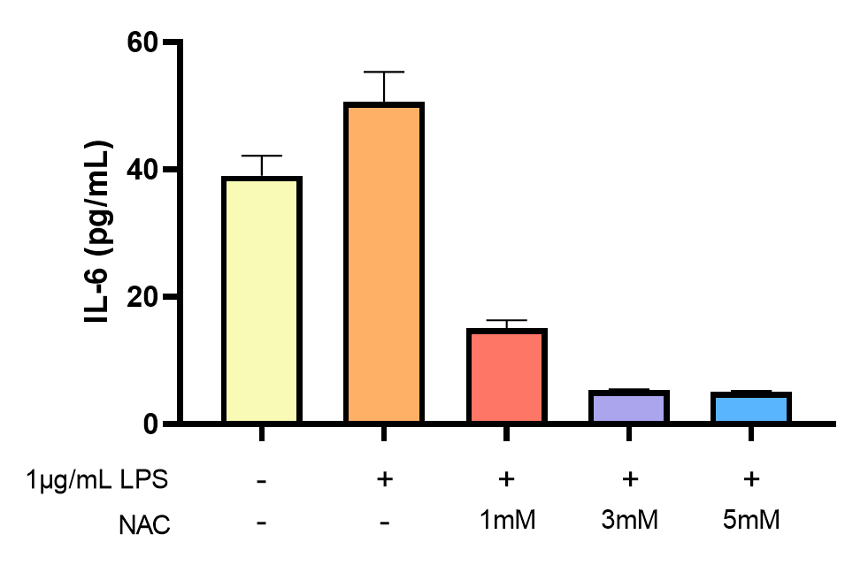

原图文件名：`52b6c69cd309fbb1e42f205d8d61ce5d.png`。整理后图片：`images/E01_ELISA_RAW_NAC_IL6.png`。

### E02 NAC · RAW · TNF-α

| 字段 | 内容 |
| --- | --- |
| 实验类别 | ELISA |
| 体系 | RAW巨噬细胞（亚系待登记） |
| 造模或培养条件 | 1 μg/mL LPS |
| 检测指标 | TNF-α |
| 单位 | pg/mL |
| Prism原文件 | 0824 tnf ELISA NAC RAW.pzfx |
| 源文件SHA256 | f2390565117d2d1aa6cbb4194c7e6b49e4ebb85d8885dc018c2cfa2780312404 |
| Prism Experiment Date | 2026-10-19（来源元信息；实际实验日期待登记） |
| 观察结果 | TNF-α 从模型组 5.165 降至 1/3/5 mM NAC 的 3.735/3.095/1.585 pg/mL；5 mM 较模型组下降约69.3%。 |
| 解释方向 | 模型组比较，降低支持炎症因子减少。 |
| 数据说明 | 每组2个数值；本节记录 NAC–RAW 的 TNF-α ELISA。 |

原表设置的子列数：3。下表R列按原顺序读取。

| 指标 | 分组 | R1 | R2 | R3 | 有效n | 均值 | SD | 比较组 | 相对变化 |
| --- | --- | --- | --- | --- | --- | --- | --- | --- | --- |
| TNF-α | Control | 2.99 | 3.25 | NA | 2 | 3.12 | 0.1838 | 1 μg/mL LPS | -39.59% |
| TNF-α | 1 μg/mL LPS | 5.57 | 4.76 | NA | 2 | 5.165 | 0.5728 | 1 μg/mL LPS | +0.00% |
| TNF-α | 1 μg/mL LPS + 1 mM NAC | 3.61 | 3.86 | NA | 2 | 3.735 | 0.1768 | 1 μg/mL LPS | -27.69% |
| TNF-α | 1 μg/mL LPS + 3 mM NAC | 2.92 | 3.27 | NA | 2 | 3.095 | 0.2475 | 1 μg/mL LPS | -40.08% |
| TNF-α | 1 μg/mL LPS + 5 mM NAC | 1.93 | 1.24 | NA | 2 | 1.585 | 0.4879 | 1 μg/mL LPS | -69.31% |

对应图片：

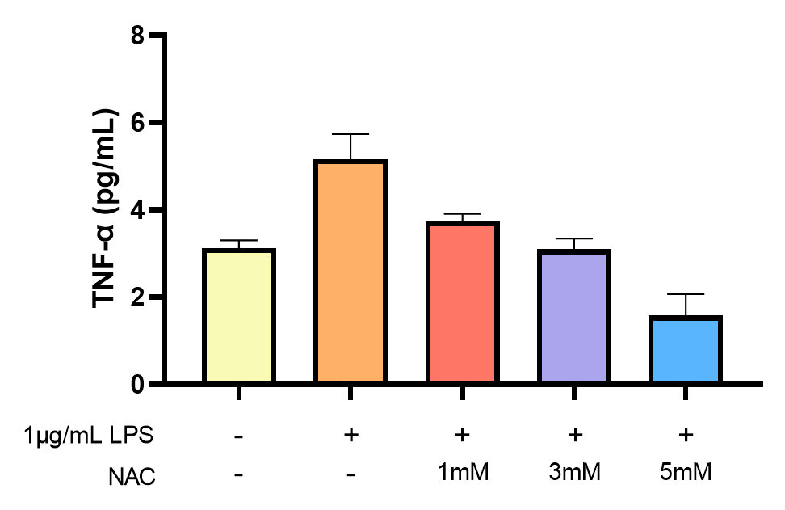

原图文件名：`a3904d3459945337db179cb716ccafb9.png`。整理后图片：`images/E02_ELISA_RAW_NAC_TNFa.png`。

### E03 SFN · RAW · IL-6

| 字段 | 内容 |
| --- | --- |
| 实验类别 | ELISA |
| 体系 | RAW巨噬细胞（亚系待登记） |
| 造模或培养条件 | 1 μg/mL LPS |
| 检测指标 | IL-6 |
| 单位 | pg/mL |
| Prism原文件 | 0824 IL-6 ELISA SFN RAW(1).pzfx |
| 源文件SHA256 | 12f6f7def7ea3875da25c5ffdd6dfa8387b309a278f501ad053ad1bc60031600 |
| Prism Experiment Date | 2026-10-19（来源元信息；实际实验日期待登记） |
| 观察结果 | IL-6 从模型组 49.473 降至 2.5/5/10/20 μM SFN 的 24.947/17.523/7.493/4.510 pg/mL；20 μM 下降约90.9%。 |
| 解释方向 | 模型组比较，降低支持炎症因子减少。 |
| 数据说明 | Prism列名为空；分组由配对图片补充。每组3个数值。 |

原表设置的子列数：3。下表R列按原顺序读取。

| 指标 | 分组 | R1 | R2 | R3 | 有效n | 均值 | SD | 比较组 | 相对变化 |
| --- | --- | --- | --- | --- | --- | --- | --- | --- | --- |
| IL-6 | Control | 43.53 | 41.24 | 36.77 | 3 | 40.5133 | 3.4381 | 1 μg/mL LPS | -18.11% |
| IL-6 | 1 μg/mL LPS | 53.97 | 47.16 | 47.29 | 3 | 49.4733 | 3.8948 | 1 μg/mL LPS | +0.00% |
| IL-6 | 1 μg/mL LPS + 2.5 μM SFN | 26.3 | 23.24 | 25.3 | 3 | 24.9467 | 1.5603 | 1 μg/mL LPS | -49.58% |
| IL-6 | 1 μg/mL LPS + 5 μM SFN | 18.99 | 17.01 | 16.57 | 3 | 17.5233 | 1.2891 | 1 μg/mL LPS | -64.58% |
| IL-6 | 1 μg/mL LPS + 10 μM SFN | 7.56 | 7.11 | 7.81 | 3 | 7.4933 | 0.3547 | 1 μg/mL LPS | -84.85% |
| IL-6 | 1 μg/mL LPS + 20 μM SFN | 4.69 | 4.06 | 4.78 | 3 | 4.51 | 0.3923 | 1 μg/mL LPS | -90.88% |

对应图片：

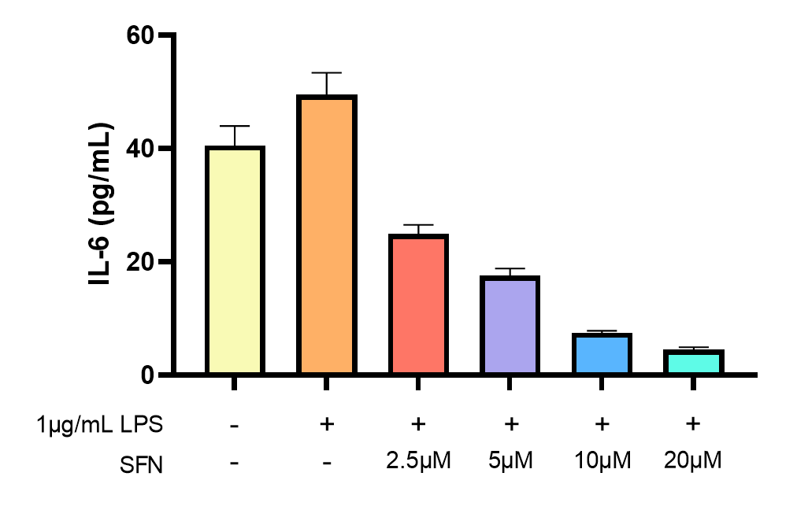

原图文件名：`8de7688cc750364a814ed09531dd7c94.png`。整理后图片：`images/E03_ELISA_RAW_SFN_IL6.png`。

### E04 SFN · BV2 · IL-6

| 字段 | 内容 |
| --- | --- |
| 实验类别 | ELISA |
| 体系 | BV2小胶质细胞 |
| 造模或培养条件 | 1 μg/mL LPS |
| 检测指标 | IL-6 |
| 单位 | pg/mL |
| Prism原文件 | 1005 IL-6 ELISA SFN BV2.pzfx |
| 源文件SHA256 | 4e83604c0478855de8454675e4a2e322ec0197908f2c4c8fe1bc1d5c47d04859 |
| Prism Experiment Date | 2026-10-19（来源元信息；实际实验日期待登记） |
| 观察结果 | IL-6 从模型组 13.843 降至 2.5/5/10/20 μM SFN 的 5.146/3.897/3.725/3.285 pg/mL；20 μM 下降约76.3%。 |
| 解释方向 | 模型组比较，降低支持炎症因子减少。 |
| 数据说明 | 每组2个数值；与 BV2 的 Il6 qPCR 是不同检测层级。 |

原表设置的子列数：3。下表R列按原顺序读取。

| 指标 | 分组 | R1 | R2 | R3 | 有效n | 均值 | SD | 比较组 | 相对变化 |
| --- | --- | --- | --- | --- | --- | --- | --- | --- | --- |
| IL-6 | Control | 6.819310465 | 8.470843331 | NA | 2 | 7.6451 | 1.1678 | 1 μg/mL LPS | -44.77% |
| IL-6 | 1 μg/mL LPS | 12.96734437 | 14.71823908 | NA | 2 | 13.8428 | 1.2381 | 1 μg/mL LPS | +0.00% |
| IL-6 | 1 μg/mL LPS + 2.5 μM SFN | 5.7560313 | 4.536911101 | NA | 2 | 5.1465 | 0.862 | 1 μg/mL LPS | -62.82% |
| IL-6 | 1 μg/mL LPS + 5 μM SFN | 3.755708198 | 4.037344927 | NA | 2 | 3.8965 | 0.1991 | 1 μg/mL LPS | -71.85% |
| IL-6 | 1 μg/mL LPS + 10 μM SFN | 3.789943862 | 3.660011307 | NA | 2 | 3.725 | 0.0919 | 1 μg/mL LPS | -73.09% |
| IL-6 | 1 μg/mL LPS + 20 μM SFN | 3.639536076 | 2.929850557 | NA | 2 | 3.2847 | 0.5018 | 1 μg/mL LPS | -76.27% |

对应图片：

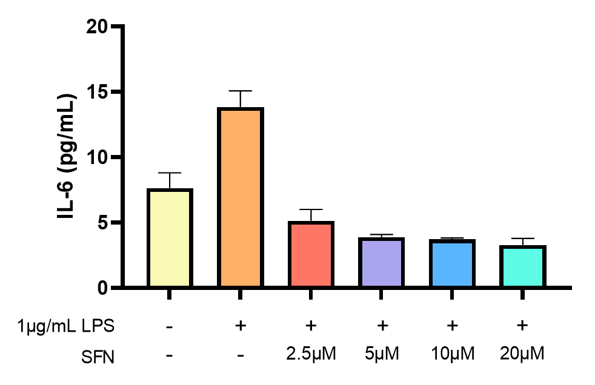

原图文件名：`8d4acc3717fd130e2a95e020a0ca1e59.png`。整理后图片：`images/E04_ELISA_BV2_SFN_IL6.png`。

### E05 Lp-Q · Gln溶液浓度 · 5 mM补加

| 字段 | 内容 |
| --- | --- |
| 实验类别 | Lp-Q_Gln |
| 体系 | Wild type 与 Lp-Q |
| 造模或培养条件 | 未额外加Gln；额外加5 mM Gln |
| 检测指标 | Gln溶液浓度 |
| 单位 | μmol/L（按图，待核实） |
| Prism原文件 | Gln浓度.pzfx |
| 源文件SHA256 | 4a8dba80bb995432bed0edb4ae7aef484aefba449d348cec0142c268b74a08cb |
| Prism Experiment Date | 2026-10-02（来源元信息；实际实验日期待登记） |
| 观察结果 | 未额外加Gln：WT 0.8541，Lp-Q 0.2901；加5 mM：WT 1.1550，Lp-Q 0.2435。Lp-Q相对WT分别低66.0%和78.9%。相对变化以同条件 WT 残余浓度为分母。 |
| 解释方向 | 若为相同初始条件下的残余浓度，则越低支持消耗更多。 |
| 数据说明 | 图轴为 Relative Gln Concentration (μmol/L)。本套记录溶液中的 Gln 浓度；补加量与培养基本底分别定义。图示p=0.0146和p<0.0001，检验方法待登记。 |

原表设置的子列数：3。下表R列按原顺序读取。

| 指标 | 分组 | R1 | R2 | R3 | 有效n | 均值 | SD | 比较组 | 相对变化 |
| --- | --- | --- | --- | --- | --- | --- | --- | --- | --- |
| Gln溶液浓度 | Wild type | 0.82571805 | 0.87956821 | 0.8569875 | 3 | 0.8541 | 0.027 | Wild type | +0.00% |
| Gln溶液浓度 | Lp-Q | 0.248386443 | 0.543515439 | 0.078543027 | 3 | 0.2901 | 0.2353 | Wild type | -66.03% |
| Gln溶液浓度 | Wild type + 5mM Gln | 1.092813924 | 1.195269187 | 1.176978546 | 3 | 1.155 | 0.0546 | Wild type + 5mM Gln | +0.00% |
| Gln溶液浓度 | Lp-Q + 5mM Gln | 0.186053088 | 0.32466116 | 0.219711519 | 3 | 0.2435 | 0.0723 | Wild type + 5mM Gln | -78.92% |

对应图片：

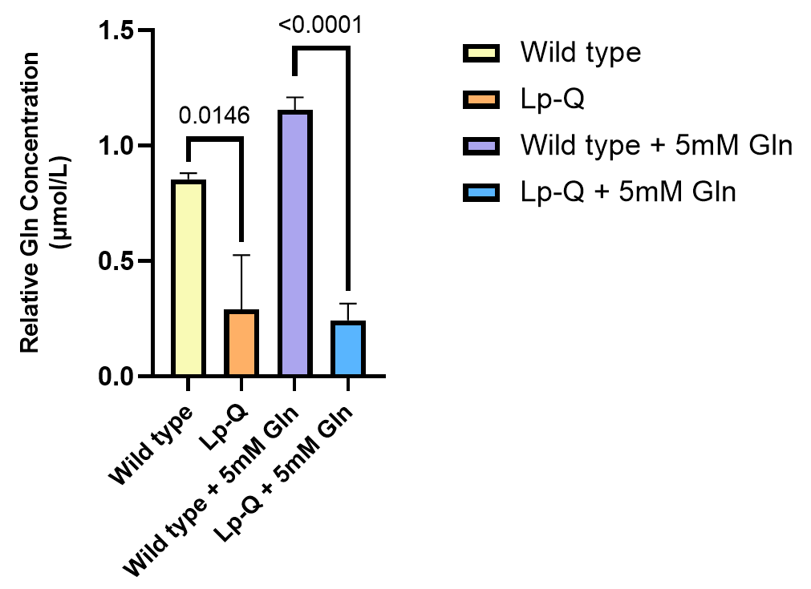

原图文件名：`ddfe0bddcf5c5db9528d2a5bd455e94a.png`。整理后图片：`images/E05_LpQ_Gln_concentration_5mM.png`。

### E06 Lp-Q · Gln降解量 · 无补加及15 mM补加

| 字段 | 内容 |
| --- | --- |
| 实验类别 | Lp-Q_Gln |
| 体系 | Wild type 与 Lp-Q |
| 造模或培养条件 | 未额外加Gln；额外加15 mM Gln |
| 检测指标 | Gln降解量（浓度当量） |
| 单位 | μmol/mL |
| Prism原文件 | Gln降解浓度.pzfx |
| 源文件SHA256 | 59b9f9bf42d9ac0e2b54cd00310f654f85b9bb07cbaf496dea4e62515f188716 |
| Prism Experiment Date | 2026-10-02（来源元信息；实际实验日期待登记） |
| 观察结果 | 未额外加Gln：WT 0.1578，Lp-Q 0.1989 μmol/mL（+26.1%）；加15 mM：WT 1.9534，Lp-Q 2.5181 μmol/mL（+28.9%）。E05 与 E06 分别保留各自的补加条件、单位和读数定义。 |
| 解释方向 | 降解量越高，支持Gln处理能力越强。 |
| 数据说明 | Prism 与降解量图片均记录 15 mM；5 mM 浓度读数归入 E05，15 mM 降解量归入 E06。WT每组2值，Lp-Q每组3值。图示p=0.0119和0.0015，统计标记来自原图。 |

原表设置的子列数：3。下表R列按原顺序读取。

| 指标 | 分组 | R1 | R2 | R3 | 有效n | 均值 | SD | 比较组 | 相对变化 |
| --- | --- | --- | --- | --- | --- | --- | --- | --- | --- |
| Gln降解量（浓度当量） | Wild type | 0.155115346 | 0.160427515 | NA | 2 | 0.1578 | 0.0038 | Wild type | +0.00% |
| Gln降解量（浓度当量） | Lp-Q | 0.188050739 | 0.206793578 | 0.201795747 | 3 | 0.1989 | 0.0097 | Wild type | +26.06% |
| Gln降解量（浓度当量） | Wild type + 15mM Gln | 1.920473343 | 1.986242978 | NA | 2 | 1.9534 | 0.0465 | Wild type + 15mM Gln | +0.00% |
| Gln降解量（浓度当量） | Lp-Q + 15mM Gln | 2.509338086 | 2.581185855 | 2.463880858 | 3 | 2.5181 | 0.0591 | Wild type + 15mM Gln | +28.91% |

对应图片：

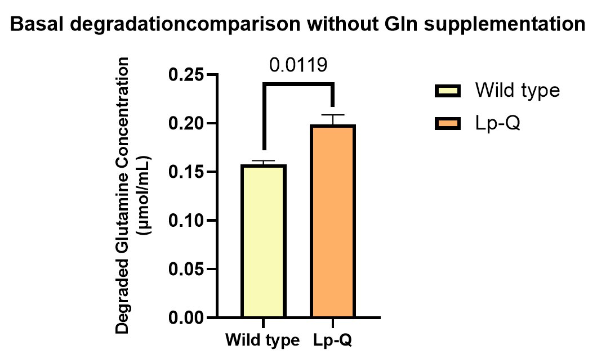

原图文件名：`ac68a3e7aa03f6c1d09ff749b2dc96be.png`。整理后图片：`images/E06a_LpQ_Gln_degradation_no_supplement.png`。

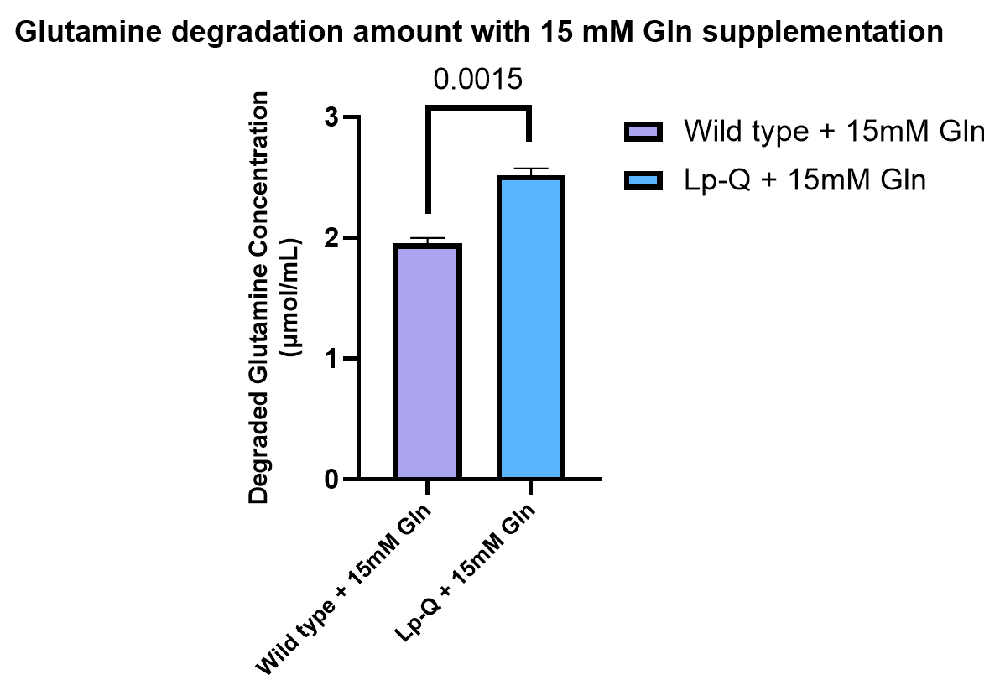

原图文件名：`bb4554334bf98a816b7fdb429c9db150.png`。整理后图片：`images/E06b_LpQ_Gln_degradation_15mM.png`。

### E07 Lp-NH3 · BCAA生成

| 字段 | 内容 |
| --- | --- |
| 实验类别 | Lp-NH3 |
| 体系 | Wild type 与 Lp-NH3 |
| 造模或培养条件 | 培养条件与氮源待登记 |
| 检测指标 | BCAA |
| 单位 | mmol/L |
| Prism原文件 | BCAA(1).pzfx |
| 源文件SHA256 | c5e8e001e3b1a7185865137cdf30e19ae28e7ae43241dcdb9472cb6c93d2e9fd |
| Prism Experiment Date | 2026-10-20（来源元信息；实际实验日期待登记） |
| 观察结果 | WT 0.6494，Lp-NH3 0.9149 mmol/L，Lp-NH3高40.9%。BCAA 积累与 E08 残余氨变化分别用于终点模型标定；氮来源分配通过模型参数及氮平衡描述。 |
| 解释方向 | 相同条件下的 BCAA 浓度用于比较产量；氮来源归属对应氮示踪测量。 |
| 数据说明 | 各3个值，第4子列为空。图示p=0.0330，检验方法待登记。结果记录 BCAA 总浓度。 |

原表设置的子列数：4。下表R列按原顺序读取。

| 指标 | 分组 | R1 | R2 | R3 | R4 | 有效n | 均值 | SD | 比较组 | 相对变化 |
| --- | --- | --- | --- | --- | --- | --- | --- | --- | --- | --- |
| BCAA | Wild type | 0.613153683 | 0.757621793 | 0.577291127 | NA | 3 | 0.6494 | 0.0955 | Wild type | +0.00% |
| BCAA | Lp-NH3 | 0.955131796 | 0.79284538 | 0.996668628 | NA | 3 | 0.9149 | 0.1077 | Wild type | +40.89% |

对应图片：

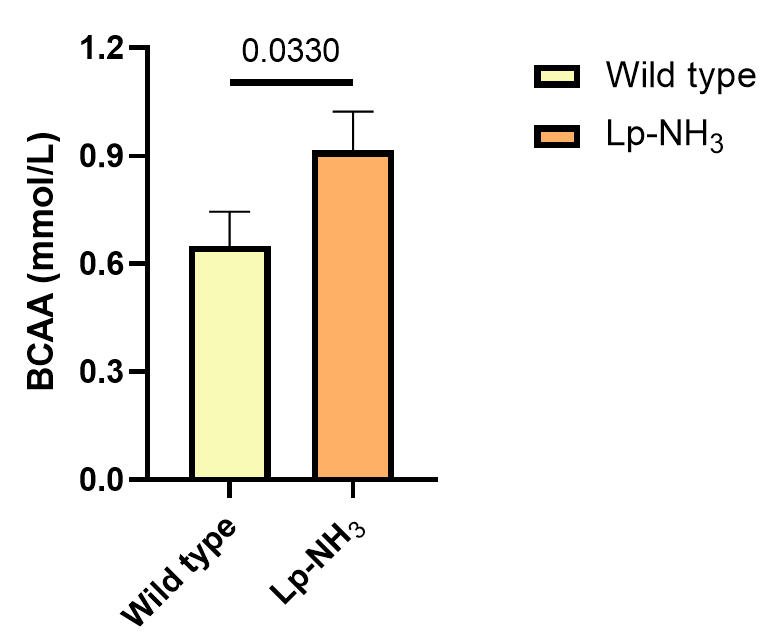

原图文件名：`85a69262b726c2aa49a2deefaa3cd88b.png`。整理后图片：`images/E07_LpNH3_BCAA_production.png`。

### E08 Lp-NH3 · 残余氨/铵

| 字段 | 内容 |
| --- | --- |
| 实验类别 | Lp-NH3 |
| 体系 | Wild type 与 Lp-NH3 |
| 造模或培养条件 | 培养条件与起始氨浓度待登记 |
| 检测指标 | NH4+残余浓度 |
| 单位 | μmol/mL |
| Prism原文件 | NH3(1).pzfx |
| 源文件SHA256 | 865c33918f95362647387a7adc0fb608a4257028846d8fba2c3a496441791f88 |
| Prism Experiment Date | 2026-10-20（来源元信息；实际实验日期待登记） |
| 观察结果 | WT 2.8073，Lp-NH3 2.1333 μmol/mL，Lp-NH3低24.0%。24.0% 表示相对 WT 终点均值的差异；起始浓度与培养时长待登记。 |
| 解释方向 | 相同初始条件下，残余氨/铵浓度越低支持去除更多。 |
| 数据说明 | 文件名NH3，图轴实际标NH4+；保留区别。各3个值，第4子列为空。图示p=0.0270，统计标记来自原图。 |

原表设置的子列数：4。下表R列按原顺序读取。

| 指标 | 分组 | R1 | R2 | R3 | R4 | 有效n | 均值 | SD | 比较组 | 相对变化 |
| --- | --- | --- | --- | --- | --- | --- | --- | --- | --- | --- |
| NH4+残余浓度 | Wild type | 2.97883546 | 2.656264311 | 2.786686294 | NA | 3 | 2.8073 | 0.1623 | Wild type | +0.00% |
| NH4+残余浓度 | Lp-NH3 | 2.302093556 | 2.312234217 | 1.785692454 | NA | 3 | 2.1333 | 0.3011 | Wild type | -24.01% |

对应图片：

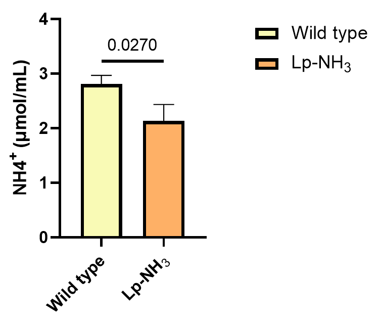

原图文件名：`1aa89496cf4a2329c3f9fd4767dd22d6.png`。整理后图片：`images/E08_LpNH3_residual_NH4.png`。

### E09 NAC · BV2 · JC-1膜电位

| 字段 | 内容 |
| --- | --- |
| 实验类别 | JC-1 |
| 体系 | BV2小胶质细胞（实验记录） |
| 造模或培养条件 | CCCP对照；1 μg/mL LPS |
| 检测指标 | JC-1 RED/GREEN |
| 单位 | 细胞比例（%） |
| Prism原文件 | JC-1 NAC 1005(3).pzfx |
| 源文件SHA256 | f878217d0e52b682f7d4b9d689da395cf89f97d44f02f99cb4d7336ba269d8a9 |
| Prism Experiment Date | 2026-10-19（来源元信息；实际实验日期待登记） |
| 观察结果 | A/M：CCCP 0.245、LPS 0.256；NAC 1/3/6/9/12 mM分别0.497/0.318/0.434/0.705/0.809。所测剂量中12 mM最高，剂量响应呈非单调变化。 |
| 解释方向 | A/M 升高用于描述膜电位相关变化；ROS 与凋亡率分别对应其专项检测。 |
| 数据说明 | 每组记录一对 RED/GREEN 汇总值，重复类型待登记。A/M 由两类细胞百分比计算；正常未损伤组和 FCS 待补充。流式拼图与 Prism 的部分门比例差异见数据记录表 Q09。 |

原表设置的子列数：1。下表R列按原顺序读取。

| 指标 | 分组 | R1 | 有效n | 均值 | SD | 比较组 | 相对变化 |
| --- | --- | --- | --- | --- | --- | --- | --- |
| RED | CCCP | 19.69 | 1 | 19.69 | NA | 1 μg/mL LPS | -3.43% |
| GREEN | CCCP | 80.31 | 1 | 80.31 | NA | 1 μg/mL LPS | +0.88% |
| RED | 1 μg/mL LPS | 20.39 | 1 | 20.39 | NA | 1 μg/mL LPS | +0.00% |
| GREEN | 1 μg/mL LPS | 79.61 | 1 | 79.61 | NA | 1 μg/mL LPS | +0.00% |
| RED | 1 μg/mL LPS + 1 mM NAC | 33.196 | 1 | 33.196 | NA | 1 μg/mL LPS | +62.81% |
| GREEN | 1 μg/mL LPS + 1 mM NAC | 66.804 | 1 | 66.804 | NA | 1 μg/mL LPS | -16.09% |
| RED | 1 μg/mL LPS + 3 mM NAC | 24.106 | 1 | 24.106 | NA | 1 μg/mL LPS | +18.22% |
| GREEN | 1 μg/mL LPS + 3 mM NAC | 75.894 | 1 | 75.894 | NA | 1 μg/mL LPS | -4.67% |
| RED | 1 μg/mL LPS + 6 mM NAC | 30.267 | 1 | 30.267 | NA | 1 μg/mL LPS | +48.44% |
| GREEN | 1 μg/mL LPS + 6 mM NAC | 69.733 | 1 | 69.733 | NA | 1 μg/mL LPS | -12.41% |
| RED | 1 μg/mL LPS + 9 mM NAC | 41.359 | 1 | 41.359 | NA | 1 μg/mL LPS | +102.84% |
| GREEN | 1 μg/mL LPS + 9 mM NAC | 58.641 | 1 | 58.641 | NA | 1 μg/mL LPS | -26.34% |
| RED | 1 μg/mL LPS + 12 mM NAC | 44.716 | 1 | 44.716 | NA | 1 μg/mL LPS | +119.30% |
| GREEN | 1 μg/mL LPS + 12 mM NAC | 55.284 | 1 | 55.284 | NA | 1 μg/mL LPS | -30.56% |

派生 A/M 表（每组一对细胞比例汇总值；SD 记为 NA）：

| 分组 | A/M = RED% / GREEN% | 相对本套LPS组变化 |
| --- | --- | --- |
| CCCP | 0.2452 | -4.27% |
| 1 μg/mL LPS | 0.2561 | +0.00% |
| 1 μg/mL LPS + 1 mM NAC | 0.4969 | +94.01% |
| 1 μg/mL LPS + 3 mM NAC | 0.3176 | +24.01% |
| 1 μg/mL LPS + 6 mM NAC | 0.434 | +69.47% |
| 1 μg/mL LPS + 9 mM NAC | 0.7053 | +175.37% |
| 1 μg/mL LPS + 12 mM NAC | 0.8088 | +215.80% |

对应图片：

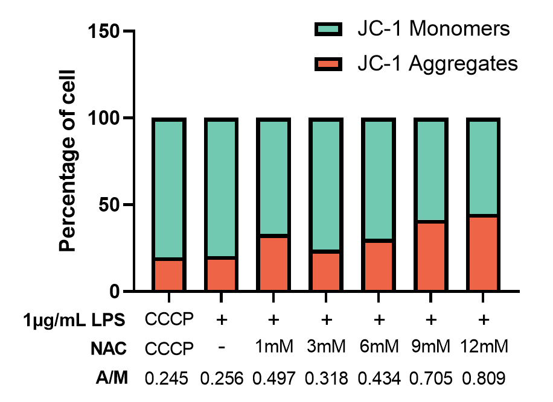

原图文件名：`44e16dc459f3f23fedeb2022926e03ad.png`。整理后图片：`images/E09a_JC1_BV2_NAC_summary.png`。

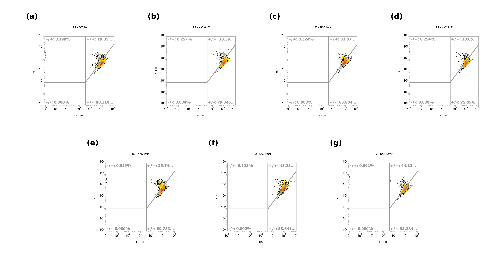

原图文件名：`95ebf9a8b96d304c90e2013a00957e48.png`。整理后图片：`images/E09b_JC1_BV2_NAC_flow_cytometry.png`。

### E10 SFN · BV2 · JC-1膜电位

| 字段 | 内容 |
| --- | --- |
| 实验类别 | JC-1 |
| 体系 | BV2小胶质细胞（实验记录） |
| 造模或培养条件 | CCCP对照；1 μg/mL LPS |
| 检测指标 | JC-1 RED/GREEN |
| 单位 | 细胞比例（%） |
| Prism原文件 | JC-1 SFN 1005.pzfx |
| 源文件SHA256 | f509880010e65df8eedc60754a02895867b067dd9a99d058bc910bdab9f43486 |
| Prism Experiment Date | 2026-10-19（来源元信息；实际实验日期待登记） |
| 观察结果 | A/M：CCCP 0.245、LPS 0.306；SFN 2.5/5/10/15/20 μM分别0.833/1.026/0.848/0.742/0.455。5 μM最高，之后下降；各给药组仍高于本套LPS组。 |
| 解释方向 | A/M 用于比较膜电位相关变化；本组在 5 μM 达到最大值。 |
| 数据说明 | 每组一对汇总值。LPS 组 RED+GREEN=99.70%，保持源文件比例；SFN 原始流式图与 FCS 待补充。 |

原表设置的子列数：1。下表R列按原顺序读取。

| 指标 | 分组 | R1 | 有效n | 均值 | SD | 比较组 | 相对变化 |
| --- | --- | --- | --- | --- | --- | --- | --- |
| RED | CCCP | 19.69 | 1 | 19.69 | NA | 1 μg/mL LPS | -15.78% |
| GREEN | CCCP | 80.31 | 1 | 80.31 | NA | 1 μg/mL LPS | +5.23% |
| RED | 1 μg/mL LPS | 23.38 | 1 | 23.38 | NA | 1 μg/mL LPS | +0.00% |
| GREEN | 1 μg/mL LPS | 76.32 | 1 | 76.32 | NA | 1 μg/mL LPS | +0.00% |
| RED | 1 μg/mL LPS + 2.5 μM SFN | 45.45 | 1 | 45.45 | NA | 1 μg/mL LPS | +94.40% |
| GREEN | 1 μg/mL LPS + 2.5 μM SFN | 54.55 | 1 | 54.55 | NA | 1 μg/mL LPS | -28.52% |
| RED | 1 μg/mL LPS + 5 μM SFN | 50.632 | 1 | 50.632 | NA | 1 μg/mL LPS | +116.56% |
| GREEN | 1 μg/mL LPS + 5 μM SFN | 49.368 | 1 | 49.368 | NA | 1 μg/mL LPS | -35.31% |
| RED | 1 μg/mL LPS + 10 μM SFN | 45.9 | 1 | 45.9 | NA | 1 μg/mL LPS | +96.32% |
| GREEN | 1 μg/mL LPS + 10 μM SFN | 54.1 | 1 | 54.1 | NA | 1 μg/mL LPS | -29.11% |
| RED | 1 μg/mL LPS + 15 μM SFN | 42.588 | 1 | 42.588 | NA | 1 μg/mL LPS | +82.16% |
| GREEN | 1 μg/mL LPS + 15 μM SFN | 57.412 | 1 | 57.412 | NA | 1 μg/mL LPS | -24.77% |
| RED | 1 μg/mL LPS + 20 μM SFN | 31.254 | 1 | 31.254 | NA | 1 μg/mL LPS | +33.68% |
| GREEN | 1 μg/mL LPS + 20 μM SFN | 68.746 | 1 | 68.746 | NA | 1 μg/mL LPS | -9.92% |

派生 A/M 表（每组一对细胞比例汇总值；SD 记为 NA）：

| 分组 | A/M = RED% / GREEN% | 相对本套LPS组变化 |
| --- | --- | --- |
| CCCP | 0.2452 | -19.97% |
| 1 μg/mL LPS | 0.3063 | +0.00% |
| 1 μg/mL LPS + 2.5 μM SFN | 0.8332 | +171.98% |
| 1 μg/mL LPS + 5 μM SFN | 1.0256 | +234.79% |
| 1 μg/mL LPS + 10 μM SFN | 0.8484 | +176.96% |
| 1 μg/mL LPS + 15 μM SFN | 0.7418 | +142.15% |
| 1 μg/mL LPS + 20 μM SFN | 0.4546 | +48.41% |

对应图片：

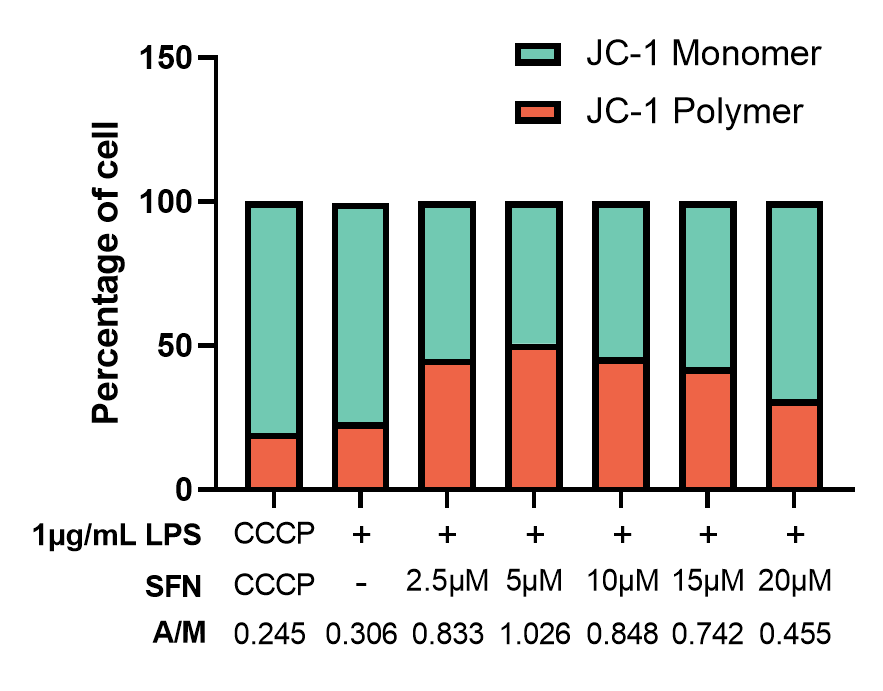

原图文件名：`f420f8761e39fc7e653690e4118df713.png`。整理后图片：`images/E10_JC1_BV2_SFN_summary.png`。

### E11 NAC · SH-SY5Y · VPA相关表达

| 字段 | 内容 |
| --- | --- |
| 实验类别 | qPCR_SH-SY5Y_NAC |
| 体系 | 人SH-SY5Y细胞 |
| 造模或培养条件 | 4 mM VPA |
| 检测指标 | NOTCH1、HES1、BECN1、JAG1 |
| 单位 | 相对表达量 |
| Prism原文件 | 0825 SH NAC(1).pzfx |
| 源文件SHA256 | 3529213a82fc046881d1a80c6d607d389aedea1475686800d10eac857d802734 |
| Prism Experiment Date | 2026-10-19（来源元信息；实际实验日期待登记） |
| 观察结果 | VPA使四个靶点均值高于Control。随NAC增加总体回落；5 mM时NOTCH1/HES1/BECN1/JAG1约1.185/1.187/1.032/0.772。高剂量 BECN1、JAG1 低于 Control，按靶点分别报告相对 Control 的偏移。 |
| 解释方向 | 按各靶点相对 Control 的偏移评估 VPA 模型及给药后的表达变化。 |
| 数据说明 | NAC剂量0/1/3/5/7 mM，另有Control。NOTCH1在1、7 mM各缺1值。基因标识按原表记录为 NOTCH1。 |

原表设置的子列数：3。下表R列按原顺序读取。

| 指标 | 分组 | R1 | R2 | R3 | 有效n | 均值 | SD | 比较组 | 相对变化 |
| --- | --- | --- | --- | --- | --- | --- | --- | --- | --- |
| NOTCH1 | Control | 1.031683 | 0.942785 | 1.028114 | 3 | 1.0009 | 0.0503 | 4mM VPA+0mM NAC | -38.30% |
| NOTCH1 | 4mM VPA+0mM NAC | 1.676362 | 1.649848 | 1.54043 | 3 | 1.6222 | 0.0721 | 4mM VPA+0mM NAC | +0.00% |
| NOTCH1 | 4mM VPA+1mM NAC | NA | 1.656341 | 1.605896 | 2 | 1.6311 | 0.0357 | 4mM VPA+0mM NAC | +0.55% |
| NOTCH1 | 4mM VPA+3mM NAC | 1.419779 | 1.458683 | 1.632029 | 3 | 1.5035 | 0.113 | 4mM VPA+0mM NAC | -7.32% |
| NOTCH1 | 4mM VPA+5mM NAC | 1.038379 | 1.359742 | 1.157758 | 3 | 1.1853 | 0.1624 | 4mM VPA+0mM NAC | -26.93% |
| NOTCH1 | 4mM VPA+7mM NAC | 1.071278 | NA | 1.135504 | 2 | 1.1034 | 0.0454 | 4mM VPA+0mM NAC | -31.98% |
| HES1 | Control | 1.017715 | 0.988514 | 0.994011 | 3 | 1.0001 | 0.0155 | 4mM VPA+0mM NAC | -52.34% |
| HES1 | 4mM VPA+0mM NAC | 1.981601 | 2.000924 | 2.312842 | 3 | 2.0985 | 0.1859 | 4mM VPA+0mM NAC | +0.00% |
| HES1 | 4mM VPA+1mM NAC | 1.771944 | 2.059556 | 2.132186 | 3 | 1.9879 | 0.1905 | 4mM VPA+0mM NAC | -5.27% |
| HES1 | 4mM VPA+3mM NAC | 1.663127 | 1.665757 | 1.641483 | 3 | 1.6568 | 0.0133 | 4mM VPA+0mM NAC | -21.05% |
| HES1 | 4mM VPA+5mM NAC | 1.27869 | 1.13498 | 1.146842 | 3 | 1.1868 | 0.0798 | 4mM VPA+0mM NAC | -43.44% |
| HES1 | 4mM VPA+7mM NAC | 1.015835 | 1.061914 | 0.983957 | 3 | 1.0206 | 0.0392 | 4mM VPA+0mM NAC | -51.37% |
| BECN1 | Control | 0.99631 | 1.02361 | 0.980552 | 3 | 1.0002 | 0.0218 | 4mM VPA+0mM NAC | -46.64% |
| BECN1 | 4mM VPA+0mM NAC | 1.943962 | 1.877743 | 1.801252 | 3 | 1.8743 | 0.0714 | 4mM VPA+0mM NAC | +0.00% |
| BECN1 | 4mM VPA+1mM NAC | 1.847618 | 1.886441 | 1.513267 | 3 | 1.7491 | 0.2052 | 4mM VPA+0mM NAC | -6.68% |
| BECN1 | 4mM VPA+3mM NAC | 1.193611 | 1.220382 | 1.293548 | 3 | 1.2358 | 0.0517 | 4mM VPA+0mM NAC | -34.06% |
| BECN1 | 4mM VPA+5mM NAC | 1.095812 | 0.988971 | 1.010451 | 3 | 1.0317 | 0.0565 | 4mM VPA+0mM NAC | -44.95% |
| BECN1 | 4mM VPA+7mM NAC | 0.811127 | 0.833353 | 0.765779 | 3 | 0.8034 | 0.0344 | 4mM VPA+0mM NAC | -57.14% |
| JAG1 | Control | 1.097586 | 1.024794 | 0.889048 | 3 | 1.0038 | 0.1058 | 4mM VPA+0mM NAC | -52.46% |
| JAG1 | 4mM VPA+0mM NAC | 2.237157 | 2.285748 | 1.812105 | 3 | 2.1117 | 0.2606 | 4mM VPA+0mM NAC | +0.00% |
| JAG1 | 4mM VPA+1mM NAC | 1.715148 | 1.685683 | 1.585935 | 3 | 1.6623 | 0.0677 | 4mM VPA+0mM NAC | -21.28% |
| JAG1 | 4mM VPA+3mM NAC | 0.923382 | 0.961927 | 0.990343 | 3 | 0.9586 | 0.0336 | 4mM VPA+0mM NAC | -54.61% |
| JAG1 | 4mM VPA+5mM NAC | 0.726818 | 0.808134 | 0.780065 | 3 | 0.7717 | 0.0413 | 4mM VPA+0mM NAC | -63.46% |
| JAG1 | 4mM VPA+7mM NAC | 0.770927 | 0.792052 | 0.745183 | 3 | 0.7694 | 0.0235 | 4mM VPA+0mM NAC | -63.56% |

对应图片：

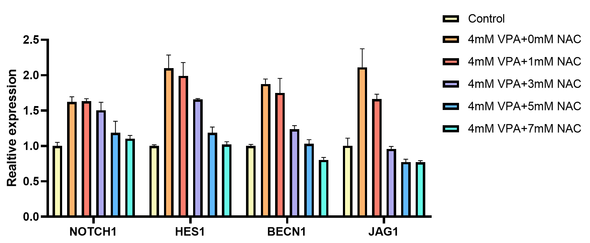

原图文件名：`09fab95c994ce0ded1ecc44f1062f21d.png`。整理后图片：`images/E11_qPCR_SHSY5Y_NAC_VPA.png`。

### E12 SFN · SH-SY5Y · 结果1（0724文件）

| 字段 | 内容 |
| --- | --- |
| 实验类别 | qPCR_SH-SY5Y_SFN |
| 体系 | 人SH-SY5Y细胞 |
| 造模或培养条件 | 300 μM H2O2 |
| 检测指标 | NFE2L2、SLC7A11、GPX4、HMOX1 |
| 单位 | 相对表达量 |
| Prism原文件 | 0724 SH SFN(1).pzfx |
| 源文件SHA256 | 88ec5a7ec503d124cd5ad4d9f3615f273a09b7c5004d3cea51f11d5946537a5d |
| Prism Experiment Date | 2026-10-19（来源元信息；实际实验日期待登记） |
| 观察结果 | HMOX1随剂量明显升高，SLC7A11升高；NFE2L2低剂量下降、20 μM回升。GPX4从模型组0.726降至20 μM的0.195，转录水平仍低于模型组。 |
| 解释方向 | 按 NFE2L2、SLC7A11、GPX4、HMOX1 分别报告转录变化及其功能关联。 |
| 数据说明 | 结果1/2按源文件编号；实验日期与批次独立登记。图片纵轴对数尺度。SFN 0/2.5/5/10/20 μM，另有Control。 |

原表设置的子列数：3。下表R列按原顺序读取。

| 指标 | 分组 | R1 | R2 | R3 | 有效n | 均值 | SD | 比较组 | 相对变化 |
| --- | --- | --- | --- | --- | --- | --- | --- | --- | --- |
| NFE2L2 | Control | 0.99539 | 1.007887 | 0.996771 | 3 | 1 | 0.0069 | 300μM H2O2+0μM SFN | +72.89% |
| NFE2L2 | 300μM H2O2+0μM SFN | 0.588725 | 0.59036 | 0.556197 | 3 | 0.5784 | 0.0193 | 300μM H2O2+0μM SFN | +0.00% |
| NFE2L2 | 300μM H2O2+2.5μM SFN | 0.298748 | 0.298955 | 0.294023 | 3 | 0.2972 | 0.0028 | 300μM H2O2+0μM SFN | -48.61% |
| NFE2L2 | 300μM H2O2+5μM SFN | 0.337744 | 0.332171 | 0.308 | 3 | 0.326 | 0.0158 | 300μM H2O2+0μM SFN | -43.65% |
| NFE2L2 | 300μM H2O2+10μM SFN | 0.378579 | 0.39193 | 0.410276 | 3 | 0.3936 | 0.0159 | 300μM H2O2+0μM SFN | -31.95% |
| NFE2L2 | 300μM H2O2+20μM SFN | 0.653987 | 0.728163 | 0.734245 | 3 | 0.7055 | 0.0447 | 300μM H2O2+0μM SFN | +21.96% |
| SLC7A11 | Control | 0.999769 | 1.009518 | 0.990801 | 3 | 1 | 0.0094 | 300μM H2O2+0μM SFN | +403.83% |
| SLC7A11 | 300μM H2O2+0μM SFN | 0.191976 | 0.203768 | 0.199713 | 3 | 0.1985 | 0.006 | 300μM H2O2+0μM SFN | +0.00% |
| SLC7A11 | 300μM H2O2+2.5μM SFN | 0.273826 | 0.261945 | 0.322268 | 3 | 0.286 | 0.032 | 300μM H2O2+0μM SFN | +44.10% |
| SLC7A11 | 300μM H2O2+5μM SFN | 0.611885 | 0.439317 | 0.640084 | 3 | 0.5638 | 0.1087 | 300μM H2O2+0μM SFN | +184.03% |
| SLC7A11 | 300μM H2O2+10μM SFN | 1.015366 | 1.066586 | 1.051902 | 3 | 1.0446 | 0.0264 | 300μM H2O2+0μM SFN | +426.29% |
| SLC7A11 | 300μM H2O2+20μM SFN | 1.539719 | 1.54828 | 1.398293 | 3 | 1.4954 | 0.0842 | 300μM H2O2+0μM SFN | +653.42% |
| GPX4 | Control | 0.965044 | 1.042948 | 0.993552 | 3 | 1.0005 | 0.0394 | 300μM H2O2+0μM SFN | +37.77% |
| GPX4 | 300μM H2O2+0μM SFN | 0.719467 | 0.752623 | 0.706617 | 3 | 0.7262 | 0.0237 | 300μM H2O2+0μM SFN | +0.00% |
| GPX4 | 300μM H2O2+2.5μM SFN | 0.36942 | 0.356589 | 0.394838 | 3 | 0.3736 | 0.0195 | 300μM H2O2+0μM SFN | -48.55% |
| GPX4 | 300μM H2O2+5μM SFN | 0.329496 | 0.30658 | 0.341352 | 3 | 0.3258 | 0.0177 | 300μM H2O2+0μM SFN | -55.14% |
| GPX4 | 300μM H2O2+10μM SFN | 0.229888 | 0.264255 | 0.27797 | 3 | 0.2574 | 0.0248 | 300μM H2O2+0μM SFN | -64.56% |
| GPX4 | 300μM H2O2+20μM SFN | 0.194072 | 0.189815 | 0.199667 | 3 | 0.1945 | 0.0049 | 300μM H2O2+0μM SFN | -73.22% |
| HMOX1 | Control | 1.002545 | 1.007421 | 0.990114 | 3 | 1 | 0.0089 | 300μM H2O2+0μM SFN | -11.74% |
| HMOX1 | 300μM H2O2+0μM SFN | 1.087488 | 1.161509 | 1.150292 | 3 | 1.1331 | 0.0399 | 300μM H2O2+0μM SFN | +0.00% |
| HMOX1 | 300μM H2O2+2.5μM SFN | 4.784384 | 4.844452 | 5.142013 | 3 | 4.9236 | 0.1915 | 300μM H2O2+0μM SFN | +334.53% |
| HMOX1 | 300μM H2O2+5μM SFN | 14.58419 | 14.185384 | 14.264263 | 3 | 14.3446 | 0.2112 | 300μM H2O2+0μM SFN | +1165.97% |
| HMOX1 | 300μM H2O2+10μM SFN | 39.396621 | 40.701216 | 39.178765 | 3 | 39.7589 | 0.8233 | 300μM H2O2+0μM SFN | +3408.87% |
| HMOX1 | 300μM H2O2+20μM SFN | 138.39679 | 147.407556 | 135.360845 | 3 | 140.3884 | 6.2654 | 300μM H2O2+0μM SFN | +12289.80% |

对应图片：

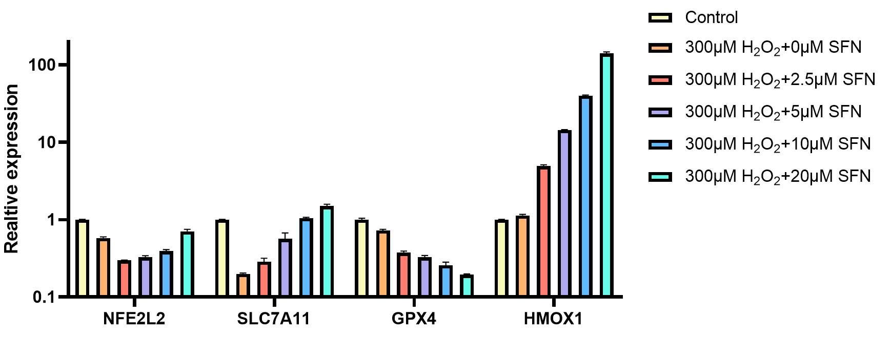

原图文件名：`32c1619a04ffcc1669cf9b5b0f63d390.png`。整理后图片：`images/E12_qPCR_SHSY5Y_SFN_H2O2_set1_0724.png`。

### E13 SFN · SH-SY5Y · 结果2（0825文件）

| 字段 | 内容 |
| --- | --- |
| 实验类别 | qPCR_SH-SY5Y_SFN |
| 体系 | 人SH-SY5Y细胞 |
| 造模或培养条件 | 300 μM H2O2 |
| 检测指标 | NFE2L2、GPX4、HMOX1、SLC7A11 |
| 单位 | 相对表达量 |
| Prism原文件 | 0825 SH SFN(1).pzfx |
| 源文件SHA256 | f8282025321b9673e7df29998c029b641561642a54f0fea24a09d7b987ec381b |
| Prism Experiment Date | 2026-10-19（来源元信息；实际实验日期待登记） |
| 观察结果 | 20 μM时NFE2L2约174.531、GPX4约30.120、HMOX1约21.154、SLC7A11=59.2。该剂量的NFE2L2和GPX4与结果1明显不同；2.5–5 μM的GPX4均低于模型组。 |
| 解释方向 | 各靶点分别报告相对表达方向和剂量非线性；功能关联结合对应表型检测。 |
| 数据说明 | 多处缺值，实际n=2或3。图片为对数纵轴。20 μM的NFE2L2、GPX4与低剂量差距很大，需回查Ct/内参/稀释/归一化及批次。两套结果分别报告。 |

原表设置的子列数：3。下表R列按原顺序读取。

| 指标 | 分组 | R1 | R2 | R3 | 有效n | 均值 | SD | 比较组 | 相对变化 |
| --- | --- | --- | --- | --- | --- | --- | --- | --- | --- |
| NFE2L2 | Control | 1.0403 | 0.961927 | 0.999307 | 3 | 1.0005 | 0.0392 | 300μM H2O2+0μM SFN | +59.03% |
| NFE2L2 | 300μM H2O2+0μM SFN | 0.795904 | 0.575811 | 0.515722 | 3 | 0.6291 | 0.1475 | 300μM H2O2+0μM SFN | +0.00% |
| NFE2L2 | 300μM H2O2+2.5μM SFN | 0.535392 | 0.432169 | NA | 2 | 0.4838 | 0.073 | 300μM H2O2+0μM SFN | -23.11% |
| NFE2L2 | 300μM H2O2+5μM SFN | 0.57415 | 0.500867 | 0.562724 | 3 | 0.5459 | 0.0394 | 300μM H2O2+0μM SFN | -13.23% |
| NFE2L2 | 300μM H2O2+10μM SFN | 1.354256 | 1.292801 | 1.072145 | 3 | 1.2397 | 0.1484 | 300μM H2O2+0μM SFN | +97.05% |
| NFE2L2 | 300μM H2O2+20μM SFN | 216.316514 | 167.497993 | 139.77863 | 3 | 174.531 | 38.7506 | 300μM H2O2+0μM SFN | +27640.96% |
| GPX4 | Control | 1.312211 | 0.920826 | 0.827597 | 3 | 1.0202 | 0.2571 | 300μM H2O2+0μM SFN | +310.36% |
| GPX4 | 300μM H2O2+0μM SFN | 0.335566 | 0.241094 | 0.169184 | 3 | 0.2486 | 0.0834 | 300μM H2O2+0μM SFN | +0.00% |
| GPX4 | 300μM H2O2+2.5μM SFN | 0.133477 | 0.12584 | 0.097982 | 3 | 0.1191 | 0.0187 | 300μM H2O2+0μM SFN | -52.09% |
| GPX4 | 300μM H2O2+5μM SFN | 0.140292 | 0.103845 | 0.102771 | 3 | 0.1156 | 0.0214 | 300μM H2O2+0μM SFN | -53.49% |
| GPX4 | 300μM H2O2+10μM SFN | 0.289674 | 0.270838 | NA | 2 | 0.2803 | 0.0133 | 300μM H2O2+0μM SFN | +12.73% |
| GPX4 | 300μM H2O2+20μM SFN | 32.022188 | 30.995782 | 27.341112 | 3 | 30.1197 | 2.4604 | 300μM H2O2+0μM SFN | +12015.01% |
| HMOX1 | Control | 0.993437 | 1.006607 | NA | 2 | 1 | 0.0093 | 300μM H2O2+0μM SFN | -68.26% |
| HMOX1 | 300μM H2O2+0μM SFN | 4.305458 | 3.11918 | 2.028153 | 3 | 3.1509 | 1.139 | 300μM H2O2+0μM SFN | +0.00% |
| HMOX1 | 300μM H2O2+2.5μM SFN | 4.695135 | 5.074152 | 4.335405 | 3 | 4.7016 | 0.3694 | 300μM H2O2+0μM SFN | +49.21% |
| HMOX1 | 300μM H2O2+5μM SFN | 1.773993 | 1.21841 | NA | 2 | 1.4962 | 0.3929 | 300μM H2O2+0μM SFN | -52.52% |
| HMOX1 | 300μM H2O2+10μM SFN | 12.693341 | 8.432731 | NA | 2 | 10.563 | 3.0127 | 300μM H2O2+0μM SFN | +235.24% |
| HMOX1 | 300μM H2O2+20μM SFN | 18.564827 | 23.744147 | NA | 2 | 21.1545 | 3.6623 | 300μM H2O2+0μM SFN | +571.37% |
| SLC7A11 | Control | 1.036462 | 0.916792 | 1.052388 | 3 | 1.0019 | 0.0741 | 300μM H2O2+0μM SFN | -74.09% |
| SLC7A11 | 300μM H2O2+0μM SFN | 4.136279 | 3.761566 | 3.702073 | 3 | 3.8666 | 0.2354 | 300μM H2O2+0μM SFN | +0.00% |
| SLC7A11 | 300μM H2O2+2.5μM SFN | 17.5492 | 13.116704 | 11.67486 | 3 | 14.1136 | 3.0614 | 300μM H2O2+0μM SFN | +265.01% |
| SLC7A11 | 300μM H2O2+5μM SFN | 24.136869 | 21.904671 | 22.210449 | 3 | 22.7507 | 1.2102 | 300μM H2O2+0μM SFN | +488.38% |
| SLC7A11 | 300μM H2O2+10μM SFN | 24.507759 | 24.271084 | 20.939668 | 3 | 23.2395 | 1.9952 | 300μM H2O2+0μM SFN | +501.03% |
| SLC7A11 | 300μM H2O2+20μM SFN | 59.3 | 66.4 | 51.9 | 3 | 59.2 | 7.2505 | 300μM H2O2+0μM SFN | +1431.05% |

对应图片：

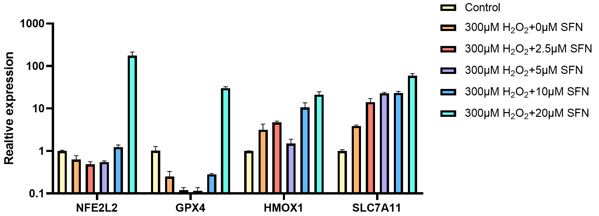

原图文件名：`97296ee36e1939633eae711a29ed5787.png`。整理后图片：`images/E13_qPCR_SHSY5Y_SFN_H2O2_set2_0825.png`。

### E14 SFN · RAW · 炎症和应激表达

| 字段 | 内容 |
| --- | --- |
| 实验类别 | qPCR_RAW_SFN |
| 体系 | RAW巨噬细胞（亚系待登记） |
| 造模或培养条件 | 1 μg/mL LPS |
| 检测指标 | Nfe2l2、Hmox1、Nos2、Il6 |
| 单位 | 相对表达量 |
| Prism原文件 | 0825 RAW SFN.pzfx |
| 源文件SHA256 | 6d107fae11c5421d390550e0a62d8bde6b394e20d99bb80dd7035f259a74d12f |
| Prism Experiment Date | 2026-10-19（来源元信息；实际实验日期待登记） |
| 观察结果 | 10–20 μM降低Nos2和Il6；但2.5 μM的Nos2/Il6分别约4.657/3.560，高于LPS模型约2.244/1.877。5 μM的Il6仍较高，按剂量分别比较与 LPS 组的表达差异。 |
| 解释方向 | Nos2、Il6下降通常支持炎症相关转录减弱；Nfe2l2/Hmox1需结合通路功能。 |
| 数据说明 | 各组每靶点3值；SFN 0/2.5/5/10/20 μM，另有Control。 |

原表设置的子列数：3。下表R列按原顺序读取。

| 指标 | 分组 | R1 | R2 | R3 | 有效n | 均值 | SD | 比较组 | 相对变化 |
| --- | --- | --- | --- | --- | --- | --- | --- | --- | --- |
| Nfe2l2 | Control | 1.199971 | 0.940174 | 0.886382 | 3 | 1.0088 | 0.1677 | 1μg/mL LPS+0μM SFN | -57.03% |
| Nfe2l2 | 1μg/mL LPS+0μM SFN | 2.285748 | 2.356534 | 2.401052 | 3 | 2.3478 | 0.0581 | 1μg/mL LPS+0μM SFN | +0.00% |
| Nfe2l2 | 1μg/mL LPS+2.5μM SFN | 4.548319 | 6.79434 | 7.799239 | 3 | 6.3806 | 1.6645 | 1μg/mL LPS+0μM SFN | +171.77% |
| Nfe2l2 | 1μg/mL LPS+5μM SFN | 4.294033 | 4.430082 | 4.797668 | 3 | 4.5073 | 0.2605 | 1μg/mL LPS+0μM SFN | +91.98% |
| Nfe2l2 | 1μg/mL LPS+10μM SFN | 2.198724 | 2.798525 | 2.686386 | 3 | 2.5612 | 0.3189 | 1μg/mL LPS+0μM SFN | +9.09% |
| Nfe2l2 | 1μg/mL LPS+20μM SFN | 2.176988 | 2.001849 | 2.089754 | 3 | 2.0895 | 0.0876 | 1μg/mL LPS+0μM SFN | -11.00% |
| Hmox1 | Control | 1.538652 | 0.705475 | 0.921251 | 3 | 1.0551 | 0.4324 | 1μg/mL LPS+0μM SFN | -59.75% |
| Hmox1 | 1μg/mL LPS+0μM SFN | 1.313425 | 3.546346 | 3.004934 | 3 | 2.6216 | 1.1648 | 1μg/mL LPS+0μM SFN | +0.00% |
| Hmox1 | 1μg/mL LPS+2.5μM SFN | 10.154167 | 10.898064 | 13.576126 | 3 | 11.5428 | 1.7998 | 1μg/mL LPS+0μM SFN | +340.30% |
| Hmox1 | 1μg/mL LPS+5μM SFN | 3.863745 | 6.10927 | 9.93142 | 3 | 6.6348 | 3.0678 | 1μg/mL LPS+0μM SFN | +153.09% |
| Hmox1 | 1μg/mL LPS+10μM SFN | 6.728726 | 7.886217 | 7.707876 | 3 | 7.4409 | 0.6232 | 1μg/mL LPS+0μM SFN | +183.84% |
| Hmox1 | 1μg/mL LPS+20μM SFN | 6.117745 | 4.453686 | 5.130146 | 3 | 5.2339 | 0.8369 | 1μg/mL LPS+0μM SFN | +99.65% |
| Nos2 | Control | 0.924663 | 1.067325 | 1.013257 | 3 | 1.0017 | 0.072 | 1μg/mL LPS+0μM SFN | -55.37% |
| Nos2 | 1μg/mL LPS+0μM SFN | 2.017637 | 2.309638 | 2.40605 | 3 | 2.2444 | 0.2022 | 1μg/mL LPS+0μM SFN | +0.00% |
| Nos2 | 1μg/mL LPS+2.5μM SFN | 4.366064 | 4.491923 | 5.113579 | 3 | 4.6572 | 0.4002 | 1μg/mL LPS+0μM SFN | +107.50% |
| Nos2 | 1μg/mL LPS+5μM SFN | 2.307504 | 2.076758 | 2.085413 | 3 | 2.1566 | 0.1308 | 1μg/mL LPS+0μM SFN | -3.92% |
| Nos2 | 1μg/mL LPS+10μM SFN | 0.536506 | 0.63098 | 0.422688 | 3 | 0.5301 | 0.1043 | 1μg/mL LPS+0μM SFN | -76.38% |
| Nos2 | 1μg/mL LPS+20μM SFN | 0.333402 | 0.416484 | 0.199898 | 3 | 0.3166 | 0.1093 | 1μg/mL LPS+0μM SFN | -85.89% |
| Il6 | Control | 1.062896 | 1.032399 | 0.911301 | 3 | 1.0022 | 0.0802 | 1μg/mL LPS+0μM SFN | -46.61% |
| Il6 | 1μg/mL LPS+0μM SFN | 1.89693 | 1.792119 | 1.942166 | 3 | 1.8771 | 0.077 | 1μg/mL LPS+0μM SFN | +0.00% |
| Il6 | 1μg/mL LPS+2.5μM SFN | 3.451763 | 3.502374 | 3.72524 | 3 | 3.5598 | 0.1455 | 1μg/mL LPS+0μM SFN | +89.65% |
| Il6 | 1μg/mL LPS+5μM SFN | 2.62321 | 2.656144 | 2.626849 | 3 | 2.6354 | 0.0181 | 1μg/mL LPS+0μM SFN | +40.40% |
| Il6 | 1μg/mL LPS+10μM SFN | 0.354699 | 0.376486 | 0.317464 | 3 | 0.3495 | 0.0298 | 1μg/mL LPS+0μM SFN | -81.38% |
| Il6 | 1μg/mL LPS+20μM SFN | 0.020494 | 0.016925 | 0.011174 | 3 | 0.0162 | 0.0047 | 1μg/mL LPS+0μM SFN | -99.14% |

对应图片：

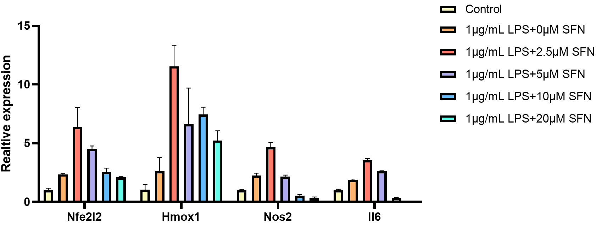

原图文件名：`53c60da8f1d80d08ed341b28332d53e1.png`。整理后图片：`images/E14_qPCR_RAW_SFN.png`。

### E15 SFN · BV2 · Nfe2l2

| 字段 | 内容 |
| --- | --- |
| 实验类别 | qPCR_BV2_SFN |
| 体系 | BV2小胶质细胞 |
| 造模或培养条件 | 1 μg/mL LPS |
| 检测指标 | Nfe2l2 |
| 单位 | 相对表达量 |
| Prism原文件 | Nfe2l2 1006 BV2 SFN(1).pzfx |
| 源文件SHA256 | 4c6c44850a82ba2eb14f14e879a3309d488d549fe96796b812cca83c932d40ac |
| Prism Experiment Date | 2026-10-19（来源元信息；实际实验日期待登记） |
| 观察结果 | Control 0.964，LPS 0.980；SFN各剂量约0.626–1.020，呈非单调剂量响应。 |
| 解释方向 | 见靶点释义；与本套LPS和Control共同比较。 |
| 数据说明 | Nfe2l2 编码 Nrf2；本节记录 mRNA 相对表达量，蛋白稳定、核转位与转录活性属于对应功能检测。 Prism列名为空，按配对图组序和柱高对应；各组3值。 |

原表设置的子列数：3。下表R列按原顺序读取。

| 指标 | 分组 | R1 | R2 | R3 | 有效n | 均值 | SD | 比较组 | 相对变化 |
| --- | --- | --- | --- | --- | --- | --- | --- | --- | --- |
| Nfe2l2 | Control | 0.939429 | 0.9510555 | 1.001187 | 3 | 0.9639 | 0.0328 | 1 μg/mL LPS | -1.67% |
| Nfe2l2 | 1 μg/mL LPS | 0.858565 | 1.167158 | 0.915099 | 3 | 0.9803 | 0.1643 | 1 μg/mL LPS | +0.00% |
| Nfe2l2 | 1 μg/mL LPS + 2.5 μM SFN | 0.487115 | 0.632586 | 0.756983 | 3 | 0.6256 | 0.1351 | 1 μg/mL LPS | -36.19% |
| Nfe2l2 | 1 μg/mL LPS + 5 μM SFN | 1.154819 | 0.755585 | 1.150824 | 3 | 1.0204 | 0.2294 | 1 μg/mL LPS | +4.09% |
| Nfe2l2 | 1 μg/mL LPS + 10 μM SFN | 0.739694 | 0.80107 | 0.836826 | 3 | 0.7925 | 0.0491 | 1 μg/mL LPS | -19.15% |
| Nfe2l2 | 1 μg/mL LPS + 15 μM SFN | 0.835667 | 0.992404 | 1.030254 | 3 | 0.9528 | 0.1032 | 1 μg/mL LPS | -2.81% |
| Nfe2l2 | 1 μg/mL LPS + 20 μM SFN | 0.925091 | 0.882499 | 1.010218 | 3 | 0.9393 | 0.065 | 1 μg/mL LPS | -4.18% |

对应图片：

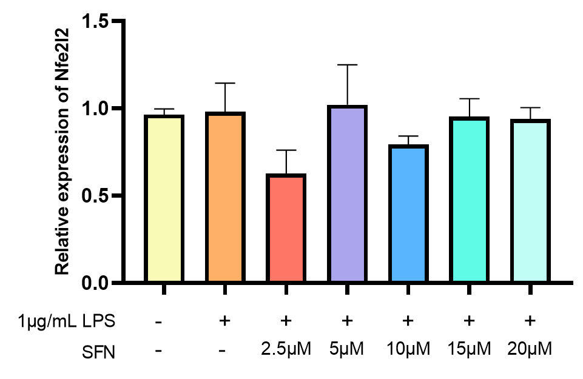

原图文件名：`2df4f92a90f2b6a6e1b335a2c1432a4e.png`。整理后图片：`images/E15_qPCR_BV2_SFN_Nfe2l2.png`。

### E16 SFN · BV2 · Hmox1

| 字段 | 内容 |
| --- | --- |
| 实验类别 | qPCR_BV2_SFN |
| 体系 | BV2小胶质细胞 |
| 造模或培养条件 | 1 μg/mL LPS |
| 检测指标 | Hmox1 |
| 单位 | 相对表达量 |
| Prism原文件 | Hmox1 1006 BV2 SFN.pzfx |
| 源文件SHA256 | a6d18fa7bc2709b6bb5a71ec95305a783af543ac0fd58e41f7054949c3dbcaea |
| Prism Experiment Date | 2026-10-19（来源元信息；实际实验日期待登记） |
| 观察结果 | Control 1.016，LPS 3.572；2.5/5/10/15/20 μM约5.636/9.809/12.200/12.014/11.314。 |
| 解释方向 | 见靶点释义；与本套LPS和Control共同比较。 |
| 数据说明 | Hmox1 表达变化用于描述应激应答，细胞功能结合对应表型测量。 Prism列名为空，按配对图组序和柱高对应；各组3值。 |

原表设置的子列数：3。下表R列按原顺序读取。

| 指标 | 分组 | R1 | R2 | R3 | 有效n | 均值 | SD | 比较组 | 相对变化 |
| --- | --- | --- | --- | --- | --- | --- | --- | --- | --- |
| Hmox1 | Control | 1.0334545 | 1.0257945 | 0.9877695 | 3 | 1.0157 | 0.0245 | 1 μg/mL LPS | -71.57% |
| Hmox1 | 1 μg/mL LPS | 3.759828 | 3.547166 | 3.409752 | 3 | 3.5722 | 0.1764 | 1 μg/mL LPS | +0.00% |
| Hmox1 | 1 μg/mL LPS + 2.5 μM SFN | 4.746947 | 6.134731 | 6.025162 | 3 | 5.6356 | 0.7716 | 1 μg/mL LPS | +57.76% |
| Hmox1 | 1 μg/mL LPS + 5 μM SFN | 10.037537 | 11.442523 | 7.946576 | 3 | 9.8089 | 1.7592 | 1 μg/mL LPS | +174.59% |
| Hmox1 | 1 μg/mL LPS + 10 μM SFN | 12.429244 | 12.122931 | 12.04754 | 3 | 12.1999 | 0.2022 | 1 μg/mL LPS | +241.52% |
| Hmox1 | 1 μg/mL LPS + 15 μM SFN | 10.805296 | 12.831934 | 12.403425 | 3 | 12.0136 | 1.0681 | 1 μg/mL LPS | +236.30% |
| Hmox1 | 1 μg/mL LPS + 20 μM SFN | 14.155917 | 9.790166 | 9.995878 | 3 | 11.314 | 2.4633 | 1 μg/mL LPS | +216.72% |

对应图片：

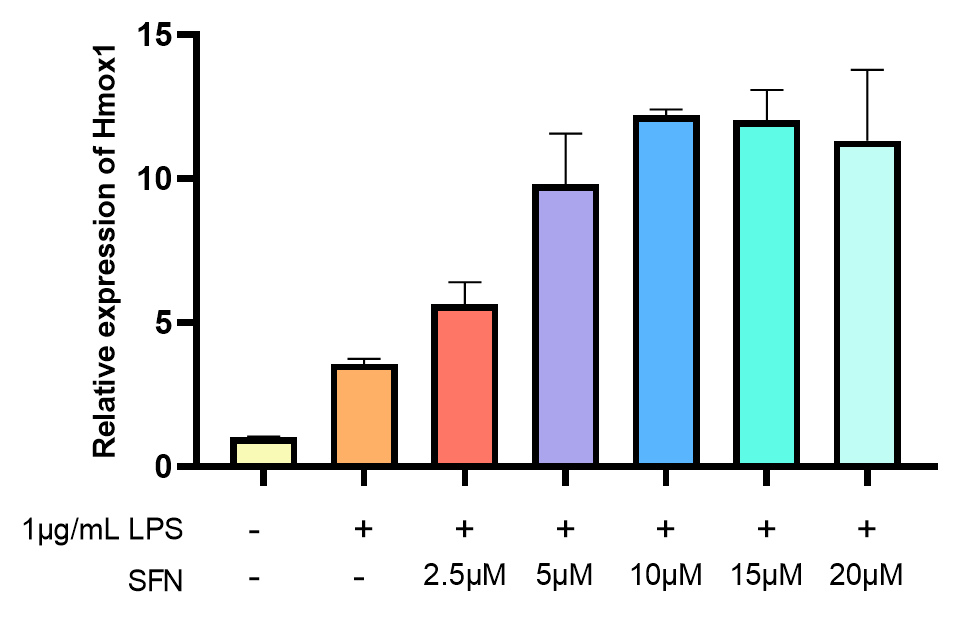

原图文件名：`94b0f48e5b979b919ec2f5b61bc0fa96.png`。整理后图片：`images/E16_qPCR_BV2_SFN_Hmox1.png`。

### E17 SFN · BV2 · Nos2

| 字段 | 内容 |
| --- | --- |
| 实验类别 | qPCR_BV2_SFN |
| 体系 | BV2小胶质细胞 |
| 造模或培养条件 | 1 μg/mL LPS |
| 检测指标 | Nos2 |
| 单位 | 相对表达量 |
| Prism原文件 | Nos2 1006 BV2 SFN(1).pzfx |
| 源文件SHA256 | d1cc766570469dd5ffc107199a583090fbce4813218449375c6d26a89995fa38 |
| Prism Experiment Date | 2026-10-19（来源元信息；实际实验日期待登记） |
| 观察结果 | LPS 0.995与Control 0.903接近；各SFN处理组约0.054–0.303，均低于LPS。 |
| 解释方向 | 见靶点释义；与本套LPS和Control共同比较。 |
| 数据说明 | 本套 LPS 与 Control 的 Nos2 均值接近；SFN 组的转录变化以这两个对照共同评估。 Prism列名为空，按配对图组序和柱高对应；各组3值。 |

原表设置的子列数：3。下表R列按原顺序读取。

| 指标 | 分组 | R1 | R2 | R3 | 有效n | 均值 | SD | 比较组 | 相对变化 |
| --- | --- | --- | --- | --- | --- | --- | --- | --- | --- |
| Nos2 | Control | 0.8215315 | 0.966853 | 0.9210235 | 3 | 0.9031 | 0.0743 | 1 μg/mL LPS | -9.25% |
| Nos2 | 1 μg/mL LPS | 1.039099 | 1.024083 | 0.922316 | 3 | 0.9952 | 0.0635 | 1 μg/mL LPS | +0.00% |
| Nos2 | 1 μg/mL LPS + 2.5 μM SFN | 0.093926 | 0.092057 | 0.081428 | 3 | 0.0891 | 0.0067 | 1 μg/mL LPS | -91.04% |
| Nos2 | 1 μg/mL LPS + 5 μM SFN | 0.276624 | 0.253666 | 0.379981 | 3 | 0.3034 | 0.0673 | 1 μg/mL LPS | -69.51% |
| Nos2 | 1 μg/mL LPS + 10 μM SFN | 0.099603 | 0.13921 | 0.147045 | 3 | 0.1286 | 0.0254 | 1 μg/mL LPS | -87.08% |
| Nos2 | 1 μg/mL LPS + 15 μM SFN | 0.088531 | 0.103905 | 0.078201 | 3 | 0.0902 | 0.0129 | 1 μg/mL LPS | -90.93% |
| Nos2 | 1 μg/mL LPS + 20 μM SFN | 0.057711 | 0.049756 | 0.0559 | 3 | 0.0545 | 0.0042 | 1 μg/mL LPS | -94.53% |

对应图片：

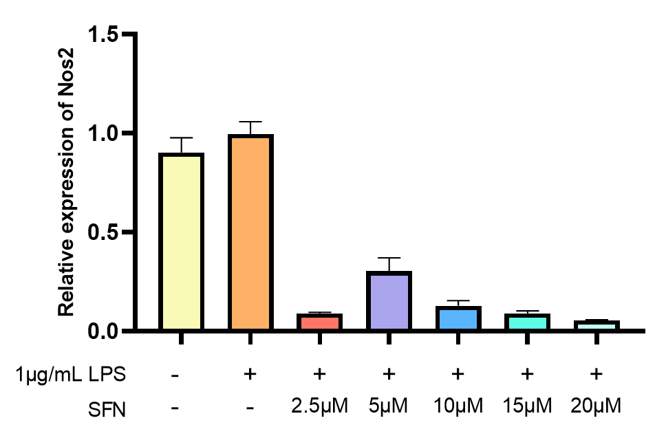

原图文件名：`920147d07ff31887b99bb56a9b8c4c8f.png`。整理后图片：`images/E17_qPCR_BV2_SFN_Nos2.png`。

### E18 SFN · BV2 · Il6

| 字段 | 内容 |
| --- | --- |
| 实验类别 | qPCR_BV2_SFN |
| 体系 | BV2小胶质细胞 |
| 造模或培养条件 | 1 μg/mL LPS |
| 检测指标 | Il6 |
| 单位 | 相对表达量 |
| Prism原文件 | IL-6 1006 BV2 SFN(1).pzfx |
| 源文件SHA256 | eef4eb860bfa272d7071e42f3b11f8d85b14c3b8007945dfecea0924acebbb59 |
| Prism Experiment Date | 2026-10-19（来源元信息；实际实验日期待登记） |
| 观察结果 | Control 5.994，LPS 86.840；2.5/5/10/15/20 μM约57.455/45.505/30.539/17.969/9.610，逐步下降。 |
| 解释方向 | 见靶点释义；与本套LPS和Control共同比较。 |
| 数据说明 | 本节记录 Il6 相对表达量，保持源表归一化尺度；Control 均值为 5.994，校准组和内参待登记。 Prism列名为空，按配对图组序和柱高对应；各组3值。 |

原表设置的子列数：3。下表R列按原顺序读取。

| 指标 | 分组 | R1 | R2 | R3 | 有效n | 均值 | SD | 比较组 | 相对变化 |
| --- | --- | --- | --- | --- | --- | --- | --- | --- | --- |
| Il6 | Control | 6.1221045 | 6.0125465 | 5.8476255 | 3 | 5.9941 | 0.1382 | 1 μg/mL LPS | -93.10% |
| Il6 | 1 μg/mL LPS | 99.640936 | 96.714927 | 64.162865 | 3 | 86.8396 | 19.693 | 1 μg/mL LPS | +0.00% |
| Il6 | 1 μg/mL LPS + 2.5 μM SFN | 54.79605 | 61.350364 | 56.21955 | 3 | 57.4553 | 3.4475 | 1 μg/mL LPS | -33.84% |
| Il6 | 1 μg/mL LPS + 5 μM SFN | 46.73182 | 44.673065 | 45.108685 | 3 | 45.5045 | 1.085 | 1 μg/mL LPS | -47.60% |
| Il6 | 1 μg/mL LPS + 10 μM SFN | 31.247452 | 30.456255 | 29.912294 | 3 | 30.5387 | 0.6714 | 1 μg/mL LPS | -64.83% |
| Il6 | 1 μg/mL LPS + 15 μM SFN | 21.019649 | 14.486796 | 18.400418 | 3 | 17.969 | 3.2877 | 1 μg/mL LPS | -79.31% |
| Il6 | 1 μg/mL LPS + 20 μM SFN | 9.430494 | 9.61531 | 9.783382 | 3 | 9.6097 | 0.1765 | 1 μg/mL LPS | -88.93% |

对应图片：

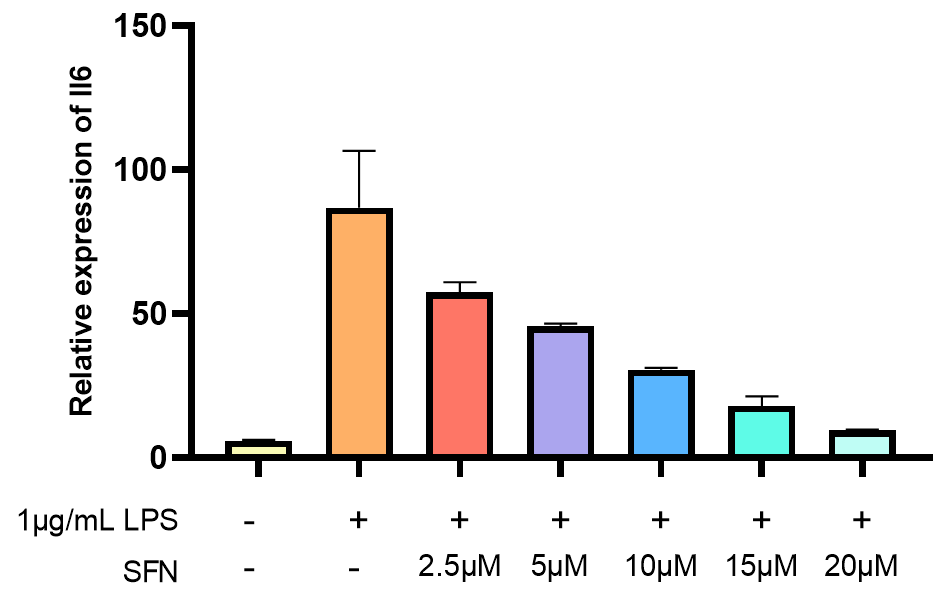

原图文件名：`d4fafb37a21992fcac3e61315fe4f8b4.png`。整理后图片：`images/E18_qPCR_BV2_SFN_Il6.png`。

### E19 SFN · BV2 · Tnf

| 字段 | 内容 |
| --- | --- |
| 实验类别 | qPCR_BV2_SFN |
| 体系 | BV2小胶质细胞 |
| 造模或培养条件 | 1 μg/mL LPS |
| 检测指标 | Tnf |
| 单位 | 相对表达量 |
| Prism原文件 | Tnf 1006 BV2 SFN(1).pzfx |
| 源文件SHA256 | ad875e829dbdbedb38ed24324fe8fed55684723fc90838328fd7ed2470228a07 |
| Prism Experiment Date | 2026-10-19（来源元信息；实际实验日期待登记） |
| 观察结果 | Control 1.016，LPS 4.695；2.5/5/10/15/20 μM约3.867/3.475/3.404/2.806/2.491，整体随剂量下降。 |
| 解释方向 | 见靶点释义；与本套LPS和Control共同比较。 |
| 数据说明 | Tnf 编码 TNF-α；此图记录 mRNA 相对表达量。重复提供的图片按文件哈希归并。 Prism列名为空，按配对图组序和柱高对应；各组3值。 |

原表设置的子列数：3。下表R列按原顺序读取。

| 指标 | 分组 | R1 | R2 | R3 | 有效n | 均值 | SD | 比较组 | 相对变化 |
| --- | --- | --- | --- | --- | --- | --- | --- | --- | --- |
| Tnf | Control | 1.0334545 | 1.0257945 | 0.9877695 | 3 | 1.0157 | 0.0245 | 1 μg/mL LPS | -78.37% |
| Tnf | 1 μg/mL LPS | 4.709803 | 4.719607 | 4.654631 | 3 | 4.6947 | 0.035 | 1 μg/mL LPS | +0.00% |
| Tnf | 1 μg/mL LPS + 2.5 μM SFN | 4.089714 | 3.54307 | 3.966867 | 3 | 3.8666 | 0.2868 | 1 μg/mL LPS | -17.64% |
| Tnf | 1 μg/mL LPS + 5 μM SFN | 4.059588 | 3.67905 | 2.685765 | 3 | 3.4748 | 0.7093 | 1 μg/mL LPS | -25.98% |
| Tnf | 1 μg/mL LPS + 10 μM SFN | 3.083709 | 3.682452 | 3.445388 | 3 | 3.4038 | 0.3015 | 1 μg/mL LPS | -27.50% |
| Tnf | 1 μg/mL LPS + 15 μM SFN | 2.765742 | 2.620181 | 3.032834 | 3 | 2.8063 | 0.2093 | 1 μg/mL LPS | -40.22% |
| Tnf | 1 μg/mL LPS + 20 μM SFN | 2.797879 | 2.299521 | 2.375668 | 3 | 2.491 | 0.2685 | 1 μg/mL LPS | -46.94% |

对应图片：

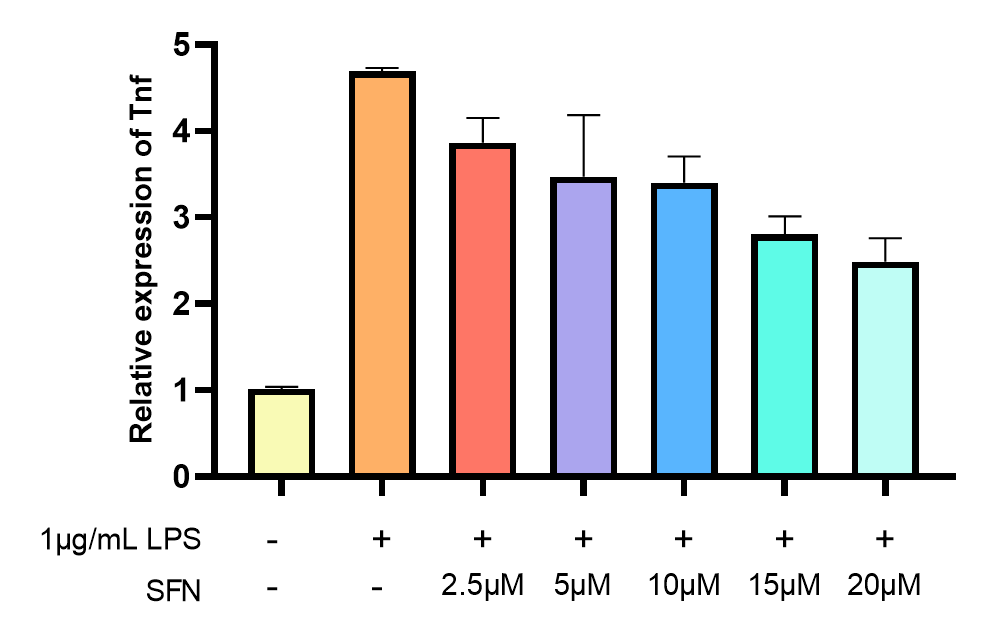

原图文件名：`e35c40fcc71b62b07e7fa0a5f75224b3.png`。整理后图片：`images/E19_qPCR_BV2_SFN_Tnf.png`。

## 靶点含义和方向

| 指标或靶点 | 含义 | 本项目判断方向 | 指标解释方法 | 解释资料 |
| --- | --- | --- | --- | --- |
| IL-6 / TNF-α（ELISA） | 炎症因子蛋白浓度 | 相对LPS模型下降 | 结合细胞数量、活力和检测条件解释蛋白浓度变化。 | [SFN在小胶质细胞中的Nrf2核转位及炎症实验](https://pmc.ncbi.nlm.nih.gov/articles/PMC5787131/) |
| Il6 / Tnf（qPCR） | 编码炎症因子的mRNA | 相对LPS模型下降 | qPCR 报告 mRNA 相对表达量；ELISA 报告对应蛋白浓度。 | [SFN在小胶质细胞中的Nrf2核转位及炎症实验](https://pmc.ncbi.nlm.nih.gov/articles/PMC5787131/) |
| Nos2 / iNOS | 诱导型一氧化氮合酶基因 | 炎症模型中下降通常符合预期 | 结合 LPS 诱导幅度解释转录变化；NO 产量使用专项测量。 | [SFN在小胶质细胞中的Nrf2核转位及炎症实验](https://pmc.ncbi.nlm.nih.gov/articles/PMC5787131/) |
| NFE2L2 / Nfe2l2 / NRF2 | 抗氧化应答转录调控 | 结合 Control、模型组和通路表型解释表达变化 | Nrf2 活性结合蛋白稳定和核转位检测；本表记录转录层变化。 | [SFN在小胶质细胞中的Nrf2核转位及炎症实验](https://pmc.ncbi.nlm.nih.gov/articles/PMC5787131/) |
| HMOX1 / Hmox1 / HO-1 | 血红素代谢与应激应答 | 升高可与应答诱导一致 | 高表达也可能反映应激；需要结合损伤和功能指标。 | [SFN在小胶质细胞中的Nrf2核转位及炎症实验](https://pmc.ncbi.nlm.nih.gov/articles/PMC5787131/) |
| GPX4 | 脂质过氧化物防御相关酶 | 在损伤模型中维持/恢复通常符合防御预期 | 本表记录转录水平；蛋白、酶活与铁死亡表型分别对应其专项检测。 | [Yang等：GPX4与铁死亡，Cell 2014](https://pmc.ncbi.nlm.nih.gov/articles/PMC4076414/) |
| SLC7A11 / xCT | 胱氨酸/谷氨酸转运相关 | 恢复可支持抗氧化底物供应方向 | 结合 GPX4、GSH 及功能检测解释表达变化。 | [Dixon等：system xc−与铁死亡，Cell 2012](https://pubmed.ncbi.nlm.nih.gov/22632970/?dopt=Abstract) |
| NOTCH1 | Notch受体 | 本套观察是否向Control回调 | 结合发育、分化背景及受体活性检测解释转录变化。 | [NCBI：NOTCH1](https://www.ncbi.nlm.nih.gov/gene?cmd=Retrieve&dopt=Graphics&list_uids=4851) |
| JAG1 | Notch配体 | 本套观察是否向Control回调 | 记录相对 Control 的偏移，并结合通路表型解释。 | [JAG1与HES1通路研究](https://pubmed.ncbi.nlm.nih.gov/16525728/) |
| HES1 | Notch相关下游转录因子 | 本套观察是否向Control回调 | 表达水平受状态和时间影响，需要结合通路及表型。 | [JAG1与HES1通路研究](https://pubmed.ncbi.nlm.nih.gov/16525728/) |
| BECN1 / Beclin 1 | 自噬相关基因 | 结合自噬功能检测解释表达变化 | 本表报告 BECN1 转录变化；自噬通量由相应功能测量评估。 | [Beclin 1神经元功能研究](https://journals.plos.org/plosgenetics/article/file?id=10.1371%2Fjournal.pgen.1004626&type=printable) |
| JC-1 A/M | 本数据中聚集体/单体细胞比例之比 | 损伤模型中升高与较高膜电位一致 | A/M = RED%/GREEN%，表示两类细胞比例之比，服务于膜电位相关比较。 | [JC-1实验原理（Thermo Fisher）](https://www.thermofisher.com/in/en/home/life-science/cell-analysis/cell-viability-and-regulation/apoptosis/mitochondria-function/jc-1-dye-mitochondrial-membrane-potential.html) |

说明：靶点资料用于说明指标功能；本批实验的观察结果来自对应 Prism 文件，按细胞类型、剂量和对照分别报告。

## 数据记录状态

| 编号 | 记录项 | 涉及实验 | 当前状态 | 数据处理方式 |
| --- | --- | --- | --- | --- |
| Q01 | Gln条件 | E05、E06 | 口述5 mM；降解量文件及图片写15 mM，浓度文件及图片写5 mM。 | 分别保留 5 mM 浓度实验与 15 mM 降解量实验，实验条件按各自源文件登记。 |
| Q02 | Gln单位与定义 | E05、E06 | 浓度图标μmol/L；降解量图标μmol/mL，两者相差1000倍。E05还使用Relative字样。 | 核对试剂盒、稀释倍数、读数换算、培养时间和起始浓度后再计算降解率。 |
| Q03 | BV2靶点覆盖 | E15–E19 | 已记录 Nfe2l2、Hmox1、Nos2、Il6、Tnf 五个靶点；重复 Tnf 图片按哈希归并。 | 其他靶点随对应实验记录补充。 |
| Q04 | 凋亡结果待处理 | 待补 | 凋亡结果处理状态：待完成。 | 凋亡率作为独立检测结果登记。 |
| Q05 | 两套SH-SY5Y SFN结果不一致 | E12、E13 | 尤其20 μM的NFE2L2/GPX4方向和幅度差异大。 | 核对批次、时间、样本标签、Ct、内参和计算；当前分别报告。 |
| Q06 | 缺失值与重复类型 | 多项 | ELISA NAC、BV2 IL-6为每组2值；部分qPCR和Gln为2值；JC-1每组一对汇总值。 | 空白保留为 NA，有效 n 为源表非空数值数量；重复类型待登记，当前报告描述性统计。 |
| Q07 | BV2 Il6归一化 | E18 | Control均值约5.994，不接近1；与其他靶点归一化标度不同。 | 保留原相对表达量及其尺度；校准组和内参待登记。 |
| Q08 | JC-1读数与对照 | E09、E10 | A/M来自RED%/GREEN%；缺正常未损伤组。SFN模型组两项合计99.70%。 | 保留原值并进行描述性比较；FCS、门控、补偿与重复类型记录待补充。 |
| Q09 | JC-1拼图与数据表 | E09 | NAC 0 mM流式拼图右下角显示79.346…%，Prism GREEN为79.61%。 | 核对是否同批同样本及导出版本；定量表使用Prism存储值并保留原图。 |
| Q10 | 统计标记 | E05–E08 | 原图有p值，但未获得可审计的检验方法、独立重复说明和分析结果表。 | p 值按原图记录，检验方法、重复类型和统计分析表待登记。 |
| Q11 | 源文件日期不一致 | 多项 | 文件名前缀0724/0824/0825/1005/1006与Prism Experiment Date元信息不完全一致。 | 分别保留文件名和 Prism 日期元信息，实际实验日期待登记。 |
| Q12 | 证据层级 | 全部 | PZFX保存的是浓度、相对表达量或细胞比例等整理后数值；缺Ct、OD/标准曲线、FCS等仪器原始记录。 | 文件对应、数值提取与图像哈希可逐项核验；仪器层全流程复算所需的 Ct、OD/标准曲线和 FCS 待补充。 |
| Q13 | 部分数据相同 | E16、E19 | Hmox1和Tnf的Control三项数值完全相同：1.0334545、1.0257945、0.9877695。 | 相同数值原样保留；共享对照或归一化来源待登记。 |
| Q14 | BCAA与氨的因果归属 | E07、E08 | BCAA升高、NH4+降低是两项终点读数，缺氮源归属或氮平衡信息。 | 报告 BCAA 产量与残余 NH4+ 变化；氮来源及转化率对应示踪或氮平衡记录。 |

BV2 的 E04 记录 IL-6 蛋白浓度，E18 记录 Il6 mRNA 相对表达量，分别属于 ELISA 与 qPCR 检测。重复提供的 Tnf 图片与 E19 原图内容及 SHA256 相同，按同一来源归并。

qPCR可复核记录要求参考 [MIQE qPCR报告规范](https://pubmed.ncbi.nlm.nih.gov/19246619/?dopt=Abstract)。

## 图片文件索引

| 实验ID | 原文件名 | 当前图片路径 | SHA256 |
| --- | --- | --- | --- |
| E01 | 52b6c69cd309fbb1e42f205d8d61ce5d.png | images/E01_ELISA_RAW_NAC_IL6.png | e10c69bad400a78898c5b0713a37bab5dbd40ec42c1e22b8d80ffda5ed28e5f8 |
| E02 | a3904d3459945337db179cb716ccafb9.png | images/E02_ELISA_RAW_NAC_TNFa.png | f1c8b1820e0b795dd97caa3e3c103ed0e5f37c67100a45c462a25e256bc37ab2 |
| E03 | 8de7688cc750364a814ed09531dd7c94.png | images/E03_ELISA_RAW_SFN_IL6.png | 4740c0d0cde6fb870721b7d2033175043ccd47b901f3aadfa1433135b792a2a1 |
| E04 | 8d4acc3717fd130e2a95e020a0ca1e59.png | images/E04_ELISA_BV2_SFN_IL6.png | 4b6fc1a5662dd61ecea4b2549c8dedef013163239e69e82ca105916f2a6fd9ad |
| E05 | ddfe0bddcf5c5db9528d2a5bd455e94a.png | images/E05_LpQ_Gln_concentration_5mM.png | 84b39e874c41cf3007315a4589fd936ab97475aad2fddd25844a9317e026dbd4 |
| E06 | ac68a3e7aa03f6c1d09ff749b2dc96be.png | images/E06a_LpQ_Gln_degradation_no_supplement.png | 6769cbbdac71962d385aa1171fccd7aa35ca1f0f1447a614f9667feb9103ecf9 |
| E06 | bb4554334bf98a816b7fdb429c9db150.png | images/E06b_LpQ_Gln_degradation_15mM.png | 94f3a673691b2b0c4bc66c6ef33fa8b0aa71592375ab740704d52bed9ee959fa |
| E07 | 85a69262b726c2aa49a2deefaa3cd88b.png | images/E07_LpNH3_BCAA_production.png | d5d8ebce2207d0dd9dd1c9a0c5ef194fb62212ce7fa59ddffa1deb7e33451a92 |
| E08 | 1aa89496cf4a2329c3f9fd4767dd22d6.png | images/E08_LpNH3_residual_NH4.png | 5cfd49852ce1a8bbeb4b45497c1084deb700fd6e28643e20c20961dcc951d178 |
| E09 | 44e16dc459f3f23fedeb2022926e03ad.png | images/E09a_JC1_BV2_NAC_summary.png | 6fabd5be39b03c6e46c9e639c695f00d154eb54ee683b94f8a34350015751b39 |
| E09 | 95ebf9a8b96d304c90e2013a00957e48.png | images/E09b_JC1_BV2_NAC_flow_cytometry.png | a32f07278ea37359af863836eb6969b4fb1ff0fcfb8e7b0e3c224774cd04e32c |
| E10 | f420f8761e39fc7e653690e4118df713.png | images/E10_JC1_BV2_SFN_summary.png | 3460902676b69202910665e1d33ea43fe006aa8d35ef56e469ed5c22832532c3 |
| E11 | 09fab95c994ce0ded1ecc44f1062f21d.png | images/E11_qPCR_SHSY5Y_NAC_VPA.png | 6188c27a82c1d8a3ce3abe0c7d963c71795ad53d044cd56454724f4740f2bce3 |
| E12 | 32c1619a04ffcc1669cf9b5b0f63d390.png | images/E12_qPCR_SHSY5Y_SFN_H2O2_set1_0724.png | 3a5e58c586abd23158b521c708ffbd43ee8b72f5195b761789a21770b22a723a |
| E13 | 97296ee36e1939633eae711a29ed5787.png | images/E13_qPCR_SHSY5Y_SFN_H2O2_set2_0825.png | 76ab9d49b322e8200a76948665563547d0c797187f473a10c76ba6127a5248e9 |
| E14 | 53c60da8f1d80d08ed341b28332d53e1.png | images/E14_qPCR_RAW_SFN.png | 16803bb2b18222ab55ce302996866cb694bca1d7b9eb0358edc11c7cd45bc088 |
| E15 | 2df4f92a90f2b6a6e1b335a2c1432a4e.png | images/E15_qPCR_BV2_SFN_Nfe2l2.png | 48e2d2d002a372ee463446cfd55b9e5f974606d3a894a56062f0066caefdb4b8 |
| E16 | 94b0f48e5b979b919ec2f5b61bc0fa96.png | images/E16_qPCR_BV2_SFN_Hmox1.png | 2c22e2d970ddd1212f161767bdc943bfe0971175b6ff55d45e45bd1093c6c934 |
| E17 | 920147d07ff31887b99bb56a9b8c4c8f.png | images/E17_qPCR_BV2_SFN_Nos2.png | 55c4ffb1287a9f80a9c78e405c1121fcb0a26ab0d4cb64c9bc2aaf29ecb19af9 |
| E18 | d4fafb37a21992fcac3e61315fe4f8b4.png | images/E18_qPCR_BV2_SFN_Il6.png | 09f1b5f3c3033ac956bb93370cba0066ee9a76c80171919a9ee175dba716495f |
| E19 | e35c40fcc71b62b07e7fa0a5f75224b3.png | images/E19_qPCR_BV2_SFN_Tnf.png | 476eb009fa3e8f790be6865f821f51a55aabc178cd0b439cbc88d8d5e3ba9f65 |

## 数据完整性

- 原目录共40个文件：19个PZFX和21个PNG，全部已建立对应关系。
- 提取的源单元格共527个，其中有效数值497个、原表空白30个。空白以 NA 保留。
- 21 张图片逐一通过 SHA256 核验，文件内容与源图片一致。
- 表中统计为描述性整理，数值、重复值和缺失状态遵循源文件；其他实验与元数据按上表记录补充。
